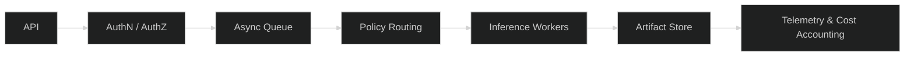
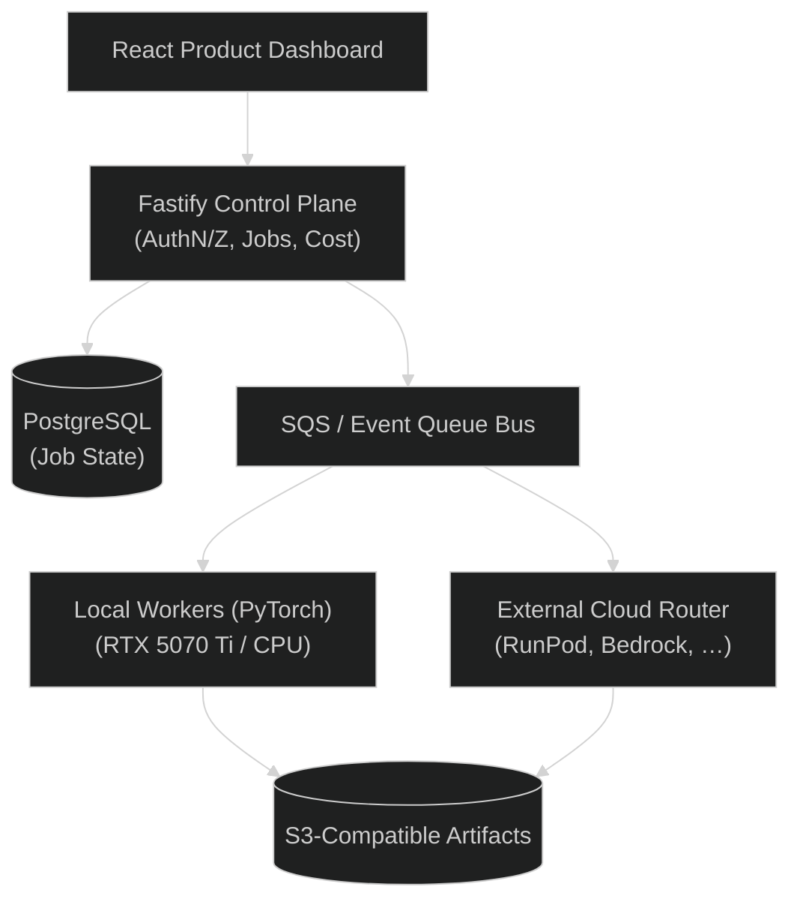

# Multi-Tenant AI Inference Platform

A production-oriented reference platform demonstrating the complete lifecycle of asynchronous, multi-tenant AI inference workloads:



Engineered for architectural coherence, measurable performance, strict tenant boundary enforcement, and reproducible local/cloud deployment.

---

## Architecture Overview



### Core Tenets

1. **Evidence Over Claims**: Every claimed capability is verified via reproducible benchmarks, load tests, or automated isolation tests. No fabricated metrics.
2. **Provider-Agnostic Core**: Business logic and contracts depend on port abstractions, not specific vendor SDKs. Cloud and local share identical contracts.
3. **Local-First, Cloud-Verifiable**: Complete functional stack runs locally without requiring paid cloud infrastructure or proprietary emulators. GPU tasks have local acceleration fallback.
4. **Strict Multi-Tenancy**: Tenant boundary enforcement at the database, queue, storage, and telemetry layers.

---

## Technology Stack

| Domain | Technology | Rationale |
|---|---|---|
| **Control Plane** | TypeScript / Fastify (`pnpm`) | High throughput, strict schema validation, deterministic error handling |
| **Inference Engine** | Python / PyTorch (`uv`) | Ecosystem standard for model lifecycle and hardware acceleration |
| **Product UI** | React + TypeScript + React Flow | Job inspector, tenant economics, and routing explanation |
| **Operational Storage** | PostgreSQL | Transactional state transitions, tenant-scoped schemas/indexes |
| **Artifact Storage** | S3-compatible (MinIO / AWS S3) | Standardized payload & model artifact isolation |
| **Queue / Scheduling** | SQS-compatible abstraction / KEDA | Decoupled asynchronous job lifecycle with DLQ & backoff |
| **Telemetry** | OpenTelemetry · Prometheus · Grafana | End-to-end tracing (`request → job → worker → artifact`) |
| **Container & Cloud** | Docker Compose · Kubernetes (Helm) · Terraform | Local parity transitioning to reproducible AWS infrastructure |

---

## Repository Structure

This repository is organized as an incremental monorepo:

```text
├── .agents/                 # AI agent operating rules, skills, and milestone specs
│   ├── milestones/          # Sequential milestones (M00 to M12)
│   └── skills/              # Specialized domain instructions (OTel, PyTorch, K8s, etc.)
├── apps/                    # Application services
│   ├── api/                 # Fastify TypeScript control plane (AuthN/Z, jobs, cost)
│   └── worker/              # Python PyTorch inference worker, provider adapters & Flyte DAG
├── packages/                # Shared workspace libraries and contracts (placeholder for M11+)
├── models/                  # Domain-organized open-weight model store & lockfile manifest
│   ├── manifest.json        # Curated model declarations & content-addressed hashes
│   ├── text-to-text/        # LLM reasoning & chat weights (Llama 3, Qwen 2.5, DeepSeek, etc.)
│   ├── text-to-image/       # Image generation weights (FLUX.1-schnell, SD 3.5)
│   ├── media-photo/         # Vision-language weights (Qwen2.5-VL, CLIP)
│   └── media-video/         # Video diffusion weights (Wan2.1, CogVideoX)
├── benchmarks/              # Reproducible inference harnesses & empirical results ledger
├── deploy/                  # Deployment & container configurations
│   ├── compose/             # Backing services config (ElasticMQ)
│   ├── helm/                # Kubernetes Helm chart (inference-platform)
│   ├── kubernetes/          # Local Kind cluster definitions
│   └── observability/       # OTel Collector, Prometheus config & Grafana dashboards
├── infrastructure/          # Cloud infrastructure as code
│   └── terraform/           # AWS modules (VPC, ECS, SQS, S3, IAM, cost guardrails) & envs
├── scripts/                 # Development, CI gate, and validation automation scripts
├── tests/                   # End-to-end, provider adapter, and unit test suites
├── docs/                    # Architecture blueprints, ADRs (0001–0012), benchmarks & operations
├── docker-compose.yml       # Local multi-service platform runtime
├── Makefile                 # Developer build, test, lint, and verification targets
├── request.rest             # REST API scratchpad with end-to-end Use Case Cycles
├── AGENTS.md                # Top-level operating manual for automated pair-programming
├── LICENSE                  # Apache 2.0 License
└── README.md
```

---

## Development Roadmap

Implementation proceeds in disciplined, incremental milestones. Each milestone is validated against explicit acceptance criteria and automated checks before merging:

| Milestone | Title | Focus | Status |
|---|---|---|---|
| **M00** | GitHub Foundation | Monorepo layout, pre-commit validation, secret scanning, and CI gate | **Done** |
| **M01** | Architecture & ADRs | Formal contracts, tenancy model, and durable technical decisions | **Done** |
| **M02** | Local Platform Skeleton | Containerized local runtime (Fastify, PostgreSQL, S3 mock, Queue) | **Done** |
| **M03** | Async Inference Lifecycle | Idempotent job handling, exponential backoff, DLQ, and cancellation | **Done** |
| **M04** | GPU Inference & Benchmarks | PyTorch worker, GPU telemetry, and reproducible performance harness | **Done** |
| **M05** | Observability | OpenTelemetry distributed tracing and Grafana operational dashboards | **Done** |
| **M06** | Kubernetes Scheduling | Helm packaging, KEDA queue autoscaling, Kueue admission, and Kyverno policies | **Done** |
| **M07** | AWS Cloud Platform | Terraform infrastructure, least-privilege IAM, and cost guardrails | _Planned_ |
| **M08** | Provider Policy Routing | Dynamic routing between local compute, RunPod, Bedrock, and SageMaker | _Planned_ |
| **M09** | Multi-Tenant Security | ABAC, tenant isolation test suites, and supply chain controls | _Planned_ |
| **M10** | GitOps & Continuous Delivery | Argo CD synchronization, environment promotion, and OIDC pipelines | _Planned_ |
| **M11** | Product Dashboard | Workload path visualization, tenant margins, and routing inspectability | _Planned_ |
| **M12** | Production Readiness | Comprehensive failure injection, load verification, and final evidence | _Planned_ |

---

## Empirical Benchmarks & Architectural Decisions Evidence

In strict accordance with `AGENTS.md` (**Evidence over claims**), all architectural trade-offs across engines, models, hardware, and providers are grounded in reproducible, empirical data:

### 1. Live Hardware Scaling & GPU vs. CPU Parity ([`benchmarks/results/index.md`](benchmarks/results/index.md))
- **Live Empirical Benchmark Ledger**: Tracks dated runs across all 12 curated models on the **NVIDIA GeForce RTX 5070 Ti (16 GB)** vs. **AMD Ryzen 9 7900 (12-Core)** under short, medium, and long prompt tiers across concurrency levels ($c \in \{1, 2, 4, 8\}$).
- **Key Findings**:
  - **Latency**: RTX 5070 Ti delivers **$11.5\times\text{--}19.1\times$ lower latency** on enterprise models (`Llama-3-8B`, `Wan2.1`, `SD 3.5`).
  - **L3-Cache Cliff**: Smaller models $\le 50\text{ MiB}$ (`TinyLlama-1.1B`) fit into CPU L3 cache with acceptable throughput ($857\text{ tok/s}$), while $\ge 7\text{B}$ models spill into DDR5 RAM, driving a massive $5\times\text{--}7\times$ marginal electricity cost advantage ($\$/1\text{M tokens}$) on GPU.
- **Web UI & Analytics Artifacts**: [`benchmarks/results/manifest.json`](benchmarks/results/manifest.json) and [`benchmarks/results/history.jsonl`](benchmarks/results/history.jsonl).

### 2. GPU Inference Engine Comparison on RTX 5070 Ti ([`benchmarks/results/index.md`](benchmarks/results/index.md))
- Live comparative benchmark of **PyTorch Eager** vs. **TorchScript JIT** vs. **PyTorch 2.x `torch.compile`** (`dynamic=True`):
  - **PyTorch Eager (`pytorch_cuda`)**: Best for local interactive serving (lowest TTFT of $0.44\text{--}0.73\text{ ms}$, peak throughput of $2,481\text{--}2,980\text{ tok/s}$, and lowest VRAM footprint).
  - **TorchScript JIT (`pytorch_torchscript_cuda`)**: Retains $94\%\text{--}99\%$ of Eager throughput for legacy pipelines with strict contract fidelity.
  - **`torch.compile` (`pytorch_torch_compile_cuda`)**: Reserved for long-context prefill and Flyte batch DAG pipelines where operator fusion offsets the $650\text{--}860\text{ ms}$ cold JIT initialization.

### 3. Multi-Engine Scenarios & Transparent Auto-Upgrade ([`docs/benchmarks/engine-comparison.md`](docs/benchmarks/engine-comparison.md))
- 40 evaluated runs across 5 engine configurations and 4 MLPerf-aligned scenarios (Interactive Chat, Summarization, Long-Context RAG, Multimodal Media Diffusion).
- Demonstrates content-addressed SHA-256 model fingerprinting to transparently auto-upgrade legacy TorchScript requests to compiled execution with zero breaking contract changes.

### 4. Enterprise Domain-Organized Model Store ([`models/README.md`](models/README.md))
- 12 open-weight models structured into 4 domain repositories (`text-to-text`, `text-to-image`, `media-photo`, `media-video`) backed by declarative lockfile [`models/manifest.json`](models/manifest.json).

---

## AI-Assisted Engineering Process

This project is built using disciplined agentic pair-programming governed by:
- **[AGENTS.md](AGENTS.md)**: Session-scoped execution constraints, non-fabrication rules, and boundary safety.
- **[Milestone Protocol](.agents/README.md)**: Strict context boundaries preventing cross-milestone scope creep and ensuring traceable, incremental development.
- **Durable Decisions (ADRs)**: Technical choices are justified with constraints and alternatives before implementation (see [`docs/adr/`](docs/adr/README.md)).

---

## Getting Started

### Prerequisites

- **Make**: Standard build automation tool
- **Node.js 22+ & pnpm 12+**: Fastify control plane API runtime and workspace package manager
- **Python 3.11+**: Inference worker, validation scripts, and automated test suites
  - **Core / CI Tier** (`apps/worker`): Pure CPU baseline (`numpy`, `psutil`, `pyyaml`). Runs on any workstation without GPU hardware or PyTorch.
  - **Hardware Acceleration Tier** (`apps/worker[gpu]`): Installed automatically via `make init` (or `pip install -e 'apps/worker[gpu]'`). Adds PyTorch (`torch>=2.1.0`) for CUDA GPU acceleration, TorchScript, and `torch.compile`.
- **Docker & Docker Compose**: Local platform runtime (PostgreSQL 16, MinIO, ElasticMQ, OTel Collector, Prometheus, Grafana)
- **Gitleaks**: Fast credential detection tool ([Installation guide](https://github.com/gitleaks/gitleaks))

### First Steps & Local Development

1. **Initialize the local environment (Python `.venv`, Corepack/`pnpm`, and workspace dependencies)**:
   ```bash
   source scripts/init_env.sh   # or: make init
   ```

2. **Option A: Start full platform & observability stack via Docker Compose**:
   ```bash
   # Starts PostgreSQL, MinIO (S3), ElasticMQ (SQS), Fastify API, OTel Collector, Prometheus (:9090), and Grafana (:3001)
   docker compose up -d --build

   # Verify all services are healthy
   docker compose ps
   ```

   #### Local Services & Endpoints Reference

   | Service | Local URL / Endpoint | Type / Interface | Credentials / Notes |
   |---|---|---|---|
   | **Fastify API** | [http://localhost:3000](http://localhost:3000) ([`/healthz`](http://localhost:3000/healthz), [`/readyz`](http://localhost:3000/readyz)) | REST API | Control plane (`/v1/jobs`) |
   | **API Swagger UI** | [http://localhost:3000/docs](http://localhost:3000/docs) ([`/docs/json`](http://localhost:3000/docs/json)) | Web UI | OpenAPI 3.0 interactive documentation |
   | **Grafana** | [http://localhost:3001](http://localhost:3001) | Web UI | `admin` / `admin` (anonymous enabled) |
   | **Prometheus** | [http://localhost:9090](http://localhost:9090) | Web UI | Metrics scraper & target graph |
   | **MinIO Console** | [http://localhost:9001](http://localhost:9001) | Web UI | `minioadmin` / `minioadmin` |
   | **MinIO S3 API** | [http://localhost:9000](http://localhost:9000) | S3 API | `minioadmin` / `minioadmin` |
   | **ElasticMQ** | [http://localhost:9324](http://localhost:9324) | SQS API | SQS-compatible job queue |
   | **PostgreSQL** | `localhost:5432` | Database | `postgres` / `postgres` (DB: `platform`) |
   | **OTel Collector** | [http://localhost:4318](http://localhost:4318) (HTTP) · `localhost:4317` (gRPC) · [http://localhost:8889](http://localhost:8889) (Metrics) | Collector | OpenTelemetry ingest & export |

   #### Control Plane API Reference & Interactive Documentation

   The Fastify control plane API exposes live OpenAPI (Swagger) documentation and machine-readable schemas:
   - **Interactive Swagger UI**: [http://localhost:3000/docs](http://localhost:3000/docs) (also aliased at [`/swagger`](http://localhost:3000/swagger) and [`/documentation`](http://localhost:3000/documentation))
   - **OpenAPI 3.0 JSON Specification**: [http://localhost:3000/docs/json](http://localhost:3000/docs/json)
   - **Developer REST Scratchpad**: [`request.rest`](request.rest) with pre-configured, sequential Use Case Cycles

   | Domain | Method & Endpoint | Purpose |
   |---|---|---|
   | **Documentation** | `GET /docs`<br/>`GET /docs/json` | Interactive Swagger UI and machine-readable OpenAPI 3.0 specification |
   | **Health** | `GET /healthz`<br/>`GET /readyz` | Liveness and dependency readiness probes (PostgreSQL, MinIO, SQS) |
   | **Metrics** | `GET /metrics` | Prometheus metrics export |
   | **Jobs** | `POST /v1/jobs`<br/>`GET /v1/jobs/:id`<br/>`POST /v1/jobs/:id/cancel`<br/>`GET /v1/jobs/dlq`<br/>`POST /v1/worker/process-next` | Asynchronous job submission, polling, cancellation, and DLQ handling |
   | **Observability** | `GET /v1/jobs/:id/trace`<br/>`GET /v1/observability/correlations/:correlationId` | W3C distributed trace retrieval and correlation ID lookup |
   | **Provider Routing** | `GET /v1/routing/providers`<br/>`POST /v1/routing/evaluate`<br/>`POST /v1/routing/simulate` | Dynamic provider policy routing (local vs. cloud GPU) |
   | **Kubernetes** | `GET /v1/k8s/autoscaling/status`<br/>`POST /v1/k8s/kueue/workloads`<br/>`POST /v1/k8s/kueue/workloads/:id/release` | KEDA queue metrics & Kueue batch admission hooks |
   | **AWS Cloud** | `GET /v1/cloud/aws/status`<br/>`POST /v1/cloud/aws/ephemeral/deploy`<br/>`POST /v1/cloud/aws/ephemeral/:runId/destroy`<br/>`POST /v1/cloud/aws/workflows/execute` | Cloud deployment status, ephemeral runs, and workflow triggers |

3. **Option B: Local development loop (API on host with hot-reload)**:
   ```bash
   # Start only backing infrastructure
   docker compose up -d postgres minio elasticmq

   # Start Fastify API with hot-reload
   cd apps/api
   pnpm dev
   ```

4. **Execute end-to-end workload cycles & populate Grafana dashboards**:
   - **Interactive REST Client**: Open [`request.rest`](request.rest) in VS Code with the REST Client extension (`humao.rest-client`) to execute Use Cases 1–9 (health probes, job lifecycle, idempotency, cancellation, retries/DLQ, PyTorch inference, W3C distributed tracing, and Kubernetes KEDA/Kueue/Kyverno scheduling).
   - **Automated Workload Simulator**:
     ```bash
     make simulate-observability
     ```
     Then open the provisioned Grafana dashboards (anonymous admin login enabled):
     - **Inference Operations (M05)**: `http://localhost:3001/d/platform-inference-operations`
     - **Kubernetes Scheduling & Autoscaling (M06)**: `http://localhost:3001/d/platform-kubernetes-scheduling`

5. **Kubernetes Helm Packaging & Validation (M06)**:
   - Render and validate the Helm chart ([`deploy/helm/inference-platform/`](deploy/helm/inference-platform/Chart.yaml)) across local CPU ([`values-local.yaml`](deploy/helm/inference-platform/values-local.yaml)) and GPU ([`values-gpu.yaml`](deploy/helm/inference-platform/values-gpu.yaml)) profiles, KEDA scaler, Kueue batch admission, and Kyverno policies:
     ```bash
     make validate-k8s
     ```

6. **Reproducible Benchmarks & Provider Diagnostics**:
   - Run the automated multi-engine category benchmark sweep across NumPy, PyTorch Eager, TorchScript, and `torch.compile`:
     ```bash
     make benchmark-engines
     ```
   - Run the concurrency, prompt-tier sweep, and Pareto cost curve harness:
     ```bash
     make benchmark-inference
     ```
   - Run the dynamic shape churn and cold scaling production reality test:
     ```bash
     make benchmark-production-reality
     ```
   - Check local hardware detection and provider adapter readiness:
     ```bash
     make check-providers
     ```

### Local Validation Gate

Run the full local CI gate before submitting pull requests or committing code:

```bash
# Run all checks: formatting, linting, types, unit tests, secrets/PII, and milestone handoff
make ci
```

Individual validation targets:
```bash
make init                   # Initialize local Python .venv, pnpm, and workspace dependencies (with GPU extras)
make format-check           # Check line endings, trailing whitespace, and EOF newlines
make lint                   # Check Python, JSON, and Mermaid diagram syntax
make typecheck              # Validate Python (mypy) and TypeScript (tsc) types
make test                   # Run Python and TypeScript unit & integration test suites
make validate-k8s           # Render Helm chart profiles and validate KEDA, Kueue, and Kyverno policies
make validate-terraform     # Validate AWS Terraform modules, IAM policies, and cost guardrails
make simulate-observability # Run live workload simulator to populate Prometheus & Grafana
make benchmark-engines      # Run multi-engine category benchmark sweep (NumPy, PyTorch, Compile)
make benchmark-inference    # Run concurrency and prompt-tier inference benchmark
make benchmark-production-reality # Run dynamic shape churn and cold scaling production test
make check-providers        # Run provider and hardware acceleration diagnostics
make scan                   # Run Gitleaks and PII pattern scanning
make handoff-check          # Validate milestone protocol compliance (.agents/README.md)
make install-hooks          # Configure local Git repository to run pre-commit hook
```

### Pre-Commit Secret Scanning

This repository strictly enforces secret prevention:
```bash
# Verify Gitleaks installation
gitleaks version

# Run standalone detection against repository
gitleaks detect --source=. --config=.gitleaks.toml --no-git --verbose
```

---

## License

Licensed under the Apache License, Version 2.0. See [LICENSE](LICENSE) for details.

