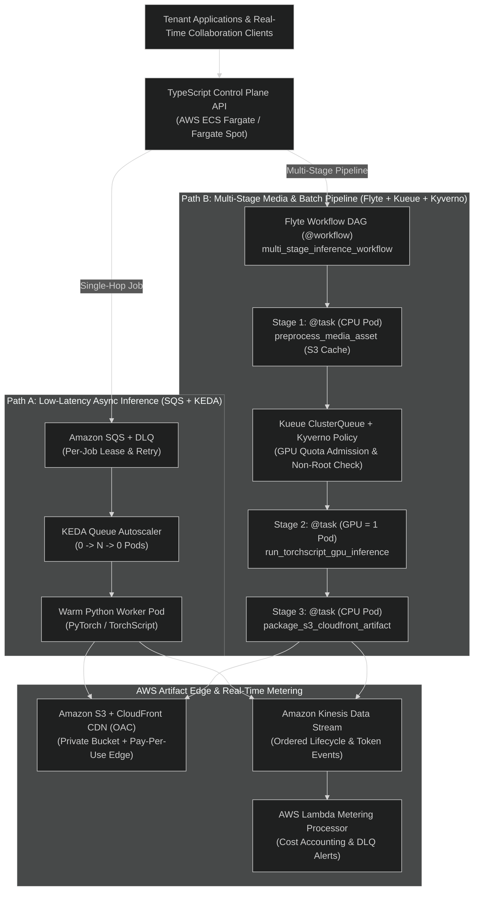
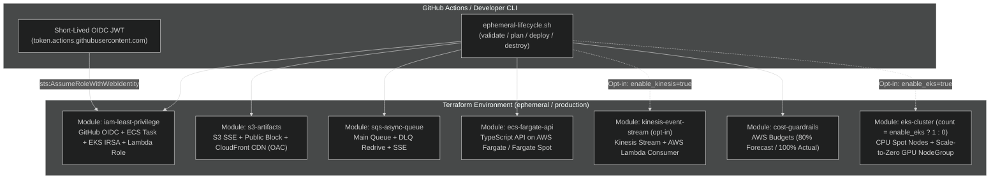
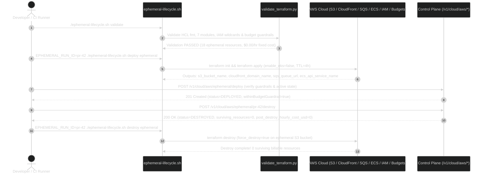

# AWS Cloud Deployment, Two-Path Orchestration, Least-Privilege IAM & Ephemeral Cost Controls (M07)

This document defines the modular Terraform architecture, **Two-Path Orchestration** (`SQS + KEDA` vs. `Flyte + Kueue + Kyverno`), short-lived OIDC/IRSA identity model, budget guardrails, and ephemeral deploy/destroy lifecycle for running the **Multi-Tenant AI Inference Platform** on AWS (see [ADR-0008](../adr/0008-keda-and-kueue-workload-responsibilities.md) and [ADR-0012](../adr/0012-ephemeral-aws-terraform-and-cost-guardrails.md)).

---

## 1. Two-Path Workload & Cloud Orchestration Architecture

The platform separates the **TypeScript Control Plane API (AWS ECS Fargate)** from the **Python PyTorch / TorchScript Inference Backend (Kubernetes / EKS)**, and routes workloads along two specialized execution paths:

1. **Path A — Low-Latency Async Inference (`SQS + KEDA`)**:
   - Single-step inference requests (`POST /v1/jobs`) are dispatched via **Amazon SQS** (`sqs-async-queue`), scaling warm Python worker pods (`0 -> N -> 0`) via **KEDA** for sub-second pickup.
2. **Path B — Multi-Stage Media & Batch DAGs (`Flyte + Kueue + Kyverno`)**:
   - Multi-step pipelines ([`apps/worker/flyte_workflow.py`](../../apps/worker/flyte_workflow.py)) execute as typed `@workflow` DAGs (`Step 1 @task CPU preprocess` $\rightarrow$ `Step 2 @task GPU=1 PyTorch/TorchScript` $\rightarrow$ `Step 3 @task CPU artifact packaging`), where only the GPU stage requests an `nvidia.com/gpu` pod admitted by **Kueue** (`ClusterQueue`) and enforced by **Kyverno** (`ClusterPolicy`).
3. **Edge Delivery & Real-Time Event Streaming (`S3 + CloudFront` & `Kinesis + Lambda`)**:
   - Artifacts are stored in private **Amazon S3** and served globally via pay-per-use **Amazon CloudFront** with Origin Access Control (OAC).
   - Out-of-band lifecycle transitions and token/cost metering events stream through **Amazon Kinesis** to an **AWS Lambda** processor so billing and real-time feeds never block GPU workers.



---

## 2. Ephemeral-First Cloud Architecture (No Permanent EKS/GPU Dependency)

To eliminate idle cloud compute bleed (`$0.10/hr` EKS control plane and `$1.00+/hr` GPU instances), the Terraform stacks separate **serverless/pay-per-use primitives** from **optional Kubernetes/GPU compute**:



---

## 3. Terraform Module Catalog

All infrastructure-as-code lives under [`infrastructure/terraform/`](../../infrastructure/terraform/) and is validated offline via `make validate-terraform` ([`scripts/validate_terraform.py`](../../scripts/validate_terraform.py)):

| Module / Root | Path | AWS Resources | Key Guardrails |
|---|---|---|---|
| **`s3-artifacts`** | [`modules/s3-artifacts/main.tf`](../../infrastructure/terraform/modules/s3-artifacts/main.tf) | `aws_s3_bucket`, `aws_s3_bucket_public_access_block`, `aws_s3_bucket_server_side_encryption_configuration`, `aws_s3_bucket_lifecycle_configuration`, `aws_cloudfront_origin_access_control`, `aws_cloudfront_distribution` | Blocks all public ACLs/policies, enforces `AES256`/`aws:kms` SSE, serves artifacts via pay-per-use CloudFront OAC (`$0.00/hr` fixed cost), and expires `tenants/*` objects after `ephemeral_retention_days`. |
| **`sqs-async-queue`** | [`modules/sqs-async-queue/main.tf`](../../infrastructure/terraform/modules/sqs-async-queue/main.tf) | `aws_sqs_queue.main`, `aws_sqs_queue.dlq`, `aws_sqs_queue_redrive_allow_policy` | Enables `sqs_managed_sse_enabled = true`, 20s long polling, and `maxReceiveCount = 3` DLQ redrive policy. |
| **`ecs-fargate-api`** | [`modules/ecs-fargate-api/main.tf`](../../infrastructure/terraform/modules/ecs-fargate-api/main.tf) | `aws_ecs_cluster`, `aws_ecs_cluster_capacity_providers`, `aws_ecs_task_definition`, `aws_ecs_service` | Runs TypeScript Fastify API on `FARGATE` / `FARGATE_SPOT` with `$0.00/hr` cluster control-plane fee, `assign_public_ip = false`, and `desired_count = 0` in ephemeral mode. |
| **`kinesis-event-stream`** | [`modules/kinesis-event-stream/main.tf`](../../infrastructure/terraform/modules/kinesis-event-stream/main.tf) | `aws_kinesis_stream`, `aws_lambda_function`, `aws_lambda_event_source_mapping` | KMS-encrypted (`alias/aws/kinesis`) `ON_DEMAND` event stream paired with a Node.js 20 Lambda metering processor. |
| **`iam-least-privilege`** | [`modules/iam-least-privilege/main.tf`](../../infrastructure/terraform/modules/iam-least-privilege/main.tf) | `aws_iam_openid_connect_provider`, `aws_iam_role` (`github_oidc_deployer`, `api_irsa`, `worker_irsa`, `keda_irsa`, `lambda_metering`), `aws_iam_role_policy` | Zero static IAM keys (`aws_iam_access_key` prohibited); zero wildcard actions (`*`, `s3:*`, `sqs:*`, `ecs:*`, `kinesis:*`, `lambda:*`) or wildcard resources (`*`). |
| **`cost-guardrails`** | [`modules/cost-guardrails/main.tf`](../../infrastructure/terraform/modules/cost-guardrails/main.tf) | `aws_budgets_budget.platform_cost_guardrail` | Enforces monthly USD cap (`$25` ephemeral / `$250` prod), 80% forecasted & 100% actual email alerts, and `EphemeralTTLHours` tags. |
| **`eks-cluster`** | [`modules/eks-cluster/main.tf`](../../infrastructure/terraform/modules/eks-cluster/main.tf) | `aws_eks_cluster`, `aws_eks_node_group` (`cpu_system`, `gpu_workers`) | Conditional via `enable_eks`; GPU node group enforces `desired_size = 0` and `gpu_min_nodes = 0`. |

---

## 4. Least-Privilege IAM Matrix (OIDC, ECS Task Role, EKS IRSA & Lambda)

Static long-lived AWS credentials (`AKIA...`) are prohibited across GitHub Actions, ECS Fargate, and Kubernetes workloads:

| Principal Role | Federation / Service Trust | Permitted Actions | Scoped Resource ARNs |
|---|---|---|---|
| **`github-oidc-deployer`** | `token.actions.githubusercontent.com:sub` $\in$ `repo:<org>/<repo>:*` | `sts:AssumeRoleWithWebIdentity` (`max_session_duration = 3600s`) | Ephemeral/production Terraform state & tagged stack resources |
| **`api-irsa`** | `ecs-tasks.amazonaws.com` + `system:serviceaccount:inference-platform:inference-api-sa` | `sqs:SendMessage`, `sqs:GetQueueAttributes`, `sqs:GetQueueUrl` (main); `sqs:ReceiveMessage` (DLQ); `s3:GetObject`, `s3:PutObject`, conditional `s3:ListBucket`; `kinesis:PutRecord`, `kinesis:PutRecords` | `${sqs_main_queue_arn}`, `${sqs_dlq_arn}`, `${s3_bucket_arn}/tenants/*`, `${kinesis_stream_arn}` |
| **`worker-irsa`** | `system:serviceaccount:inference-workers:inference-worker-sa` | `sqs:ReceiveMessage`, `sqs:DeleteMessage`, `sqs:ChangeMessageVisibility` (main); `sqs:SendMessage` (DLQ); `s3:GetObject`, `s3:PutObject`; `kinesis:PutRecord`, `kinesis:PutRecords`; `bedrock:InvokeModel`, `sagemaker:InvokeEndpoint` | `${sqs_main_queue_arn}`, `${sqs_dlq_arn}`, `${s3_bucket_arn}/tenants/*`, `${kinesis_stream_arn}`, `arn:aws:bedrock:${region}::foundation-model/meta.llama3-*` |
| **`keda-irsa`** | `system:serviceaccount:inference-platform:keda-operator` | Read-only `sqs:GetQueueAttributes`, `sqs:GetQueueUrl` | `${sqs_main_queue_arn}` |
| **`lambda-metering-role`** | `lambda.amazonaws.com` | `kinesis:GetRecords`, `kinesis:GetShardIterator`, `kinesis:DescribeStream`, `kinesis:DescribeStreamSummary`, `kinesis:ListShards` | `${kinesis_stream_arn}` |

---

## 5. Budget & Cost Guardrails

All cost numbers below are labeled **Estimated** (based on `eu-central-1` on-demand/Spot pricing and Terraform configuration defaults):

| Profile | `enable_eks` | `gpu_min_nodes` | Fixed Hourly Cost (Estimated) | 4-Hour Ephemeral Run Cost (Estimated) | Monthly Budget Cap (`aws_budgets_budget`) |
|---|---|---|---|---|---|
| **Ephemeral Default (S3 + CloudFront + SQS + ECS Fargate `0` tasks + IAM)** | `false` | `0` | **`$0.000 / hr`** | **`$0.00`** (pay-per-request only) | `$25.00 / month` |
| **Ephemeral + EKS Opt-In (CPU Spot + Scale-to-Zero GPU)** | `true` | `0` | **`$0.133 / hr`** (`$0.10` EKS + `$0.033` Spot `t3.large`) | **`$0.53`** | `$25.00 / month` |
| **Production Baseline (Idle Queue, Scale-to-Zero GPU)** | `true` | `0` | **`$0.266 / hr`** (`$0.10` EKS + 2x `$0.083` `t3.large`) | N/A (`$194.18 / month`) | `$250.00 / month` |

---

## 6. Ephemeral Deploy / Verify / Destroy Workflow



### Verification & Execution Commands

```bash
# 1. Offline static analysis, IAM least-privilege check, cost guardrail check & lifecycle simulation
make validate-terraform

# 2. Validate via the ephemeral lifecycle CLI wrapper
./infrastructure/terraform/scripts/ephemeral-lifecycle.sh validate

# 3. Ephemeral cloud plan / deploy / destroy (uses Terraform CLI when installed + AWS OIDC credentials)
EPHEMERAL_RUN_ID=smoke-01 ./infrastructure/terraform/scripts/ephemeral-lifecycle.sh plan ephemeral
EPHEMERAL_RUN_ID=smoke-01 ./infrastructure/terraform/scripts/ephemeral-lifecycle.sh deploy ephemeral
EPHEMERAL_RUN_ID=smoke-01 ./infrastructure/terraform/scripts/ephemeral-lifecycle.sh destroy ephemeral
```
