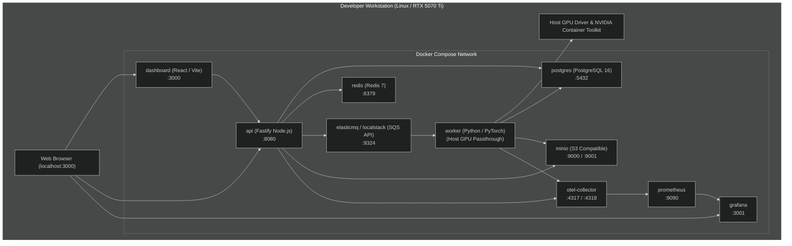
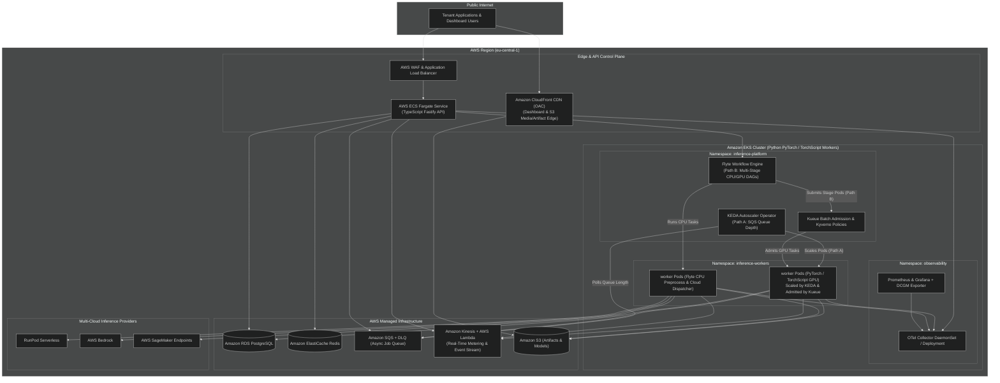

# Deployment Topology

This document details the physical and orchestration topologies for both local development and cloud production deployments of the **Multi-Tenant AI Inference Platform**.

---

## 1. Local Development Topology (Docker Compose)

The local environment provides full architectural fidelity without requiring active cloud credentials or paid managed services. All services run within Docker Compose, with optional hardware passthrough for host GPU acceleration.

### Local Dev Port Allocation

| Service | Internal Port | Host Port | Purpose |
|---|---|---|---|
| `dashboard` | 3000 | 3000 | React Product Dashboard |
| `api` | 8080 | 8080 | Fastify Control Plane API |
| `grafana` | 3000 | 3001 | Operational Monitoring Dashboards |
| `postgres` | 5432 | 5432 | Primary Relational Database |
| `redis` | 6379 | 6379 | Ephemeral State & Cache |
| `minio` | 9000, 9001 | 9000, 9001 | S3 API & MinIO Console |
| `elasticmq` | 9324 | 9324 | SQS-Compatible Message Queue |
| `prometheus` | 9090 | 9090 | Prometheus Metrics Storage |
| `otel-collector` | 4317, 4318 | 4317, 4318 | OTel gRPC / HTTP Ingestion |

---

## 2. Cloud Production Topology (AWS ECS Fargate, EKS, CloudFront, SQS & Kinesis)

The cloud production topology targets AWS managed with Terraform and reconciled via Argo CD. The stateless **TypeScript Control Plane API** runs on **AWS ECS Fargate** (decoupled from GPU cluster maintenance), while **Python PyTorch / TorchScript** inference workers run on **Amazon EKS** orchestrated via two workload paths:
- **Path A (Low-Latency Queue)**: **Amazon SQS** + **KEDA** scales warm worker pods (`0 -> N -> 0`).
- **Path B (Multi-Stage DAG Pipeline)**: **Flyte** (`@workflow` / `@task`) + **Kueue** (`ClusterQueue` GPU quota admission) + **Kyverno** (`ClusterPolicy` enforcement).
- **Edge & Streaming Building Blocks**: **Amazon S3 + CloudFront (OAC)** for media/artifact delivery, and **Amazon Kinesis + AWS Lambda** for out-of-band token metering and lifecycle event streaming.

---

## 3. Kubernetes Autoscaling & Two-Path Orchestration Architecture

The platform separates real-time API scaling, single-hop queue scaling, and multi-stage batch/media DAG admission (see [ADR-0008](../adr/0008-keda-and-kueue-workload-responsibilities.md)):

1. **Control Plane Scaling (ECS Fargate / K8s HPA)**:
   - Stateless TypeScript `api` tasks run on **AWS ECS Fargate** ([`modules/ecs-fargate-api`](../../infrastructure/terraform/modules/ecs-fargate-api/main.tf)) or scale in-cluster via Kubernetes HPA ([`templates/api-hpa.yaml`](../../deploy/helm/inference-platform/templates/api-hpa.yaml)).
2. **Path A — Worker Queue-Depth Autoscaling (SQS + KEDA)**:
   - Inference workers scale from `0` to `maxReplicaCount` using KEDA ([`templates/keda-scaledobject.yaml`](../../deploy/helm/inference-platform/templates/keda-scaledobject.yaml)) measuring SQS queue depth (`ApproximateNumberOfMessagesVisible`) and Prometheus `queue_messages_visible`.
3. **Path B — Multi-Stage Media/Batch DAGs & GPU Quota Admission (Flyte + Kueue + Kyverno)**:
   - Multi-stage workflows ([`apps/worker/flyte_workflow.py`](../../apps/worker/flyte_workflow.py)) run CPU preprocessing and S3/CloudFront packaging on cheap CPU pods while requesting GPU quota (`nvidia.com/gpu: 1`) exclusively for the PyTorch/TorchScript inference stage.
   - Multi-tenant GPU quota sharing and priority queueing (`inference-realtime-high` > `inference-batch-standard` > `inference-batch-backfill`) are governed by Kueue ([`templates/kueue-admission.yaml`](../../deploy/helm/inference-platform/templates/kueue-admission.yaml)) and validated by Kyverno ([`templates/kyverno-policies.yaml`](../../deploy/helm/inference-platform/templates/kyverno-policies.yaml)).

---

## 4. Helm Packaging, Profiles & Policy Governance (M06)

All Kubernetes resources are packaged in [`deploy/helm/inference-platform/`](../../deploy/helm/inference-platform/Chart.yaml) and validated via `make validate-k8s` ([`scripts/validate_kubernetes.py`](../../scripts/validate_kubernetes.py)):

| Artifact / Profile | Path | Purpose |
|---|---|---|
| **Local Kind Cluster** | [`deploy/kubernetes/kind-cluster.yaml`](../../deploy/kubernetes/kind-cluster.yaml) | 3-node local cluster topology (control-plane, CPU general worker node, and tainted GPU worker node). |
| **Default Values** | [`deploy/helm/inference-platform/values.yaml`](../../deploy/helm/inference-platform/values.yaml) | Baseline chart values for namespaces (`inference-platform`, `inference-workers`, `observability`), API, worker, KEDA, Kueue, and Kyverno. |
| **Local CPU Profile** | [`deploy/helm/inference-platform/values-local.yaml`](../../deploy/helm/inference-platform/values-local.yaml) | CPU-fallback worker profile (`nvidiaGpu: 0`, `NodePort: 30080`, `dcgmExporter.enabled: false`). |
| **GPU Node Profile** | [`deploy/helm/inference-platform/values-gpu.yaml`](../../deploy/helm/inference-platform/values-gpu.yaml) | GPU worker profile (`runtimeClassName: nvidia`, `nvidia.com/gpu: 1`, GPU nodeSelector/tolerations, and `dcgm-exporter` `DaemonSet` enabled). |
| **AWS Ephemeral Profile** | [`deploy/helm/inference-platform/values-aws-ephemeral.yaml`](../../deploy/helm/inference-platform/values-aws-ephemeral.yaml) | Configures control plane and KEDA against ephemeral AWS S3 (`s3.eu-central-1.amazonaws.com`) and SQS (`sqs.eu-central-1.amazonaws.com`) with scale-to-zero workers. |
| **Kyverno Policies** | [`deploy/helm/inference-platform/templates/kyverno-policies.yaml`](../../deploy/helm/inference-platform/templates/kyverno-policies.yaml) | Enforces `require-non-root-and-drop-capabilities`, `require-workload-resource-bounds`, and `require-tenant-isolation-labels` (see [ADR-0011](../adr/0011-kyverno-admission-policy-enforcement.md)). |

---

## 5. AWS Terraform Modules, Least-Privilege IAM & Ephemeral Cost Controls (M07)

Cloud infrastructure (`s3-artifacts` + CloudFront, `sqs-async-queue`, `ecs-fargate-api`, `kinesis-event-stream` + Lambda, `iam-least-privilege`, `cost-guardrails`, and `eks-cluster`) is provisioned via modular Terraform under [`infrastructure/terraform/`](../../infrastructure/terraform/) and validated offline via `make validate-terraform` ([`scripts/validate_terraform.py`](../../scripts/validate_terraform.py)). Detailed IAM boundaries, cost budgets, and ephemeral teardown workflows are documented in [`docs/architecture/aws-deployment.md`](aws-deployment.md) and [ADR-0012](../adr/0012-ephemeral-aws-terraform-and-cost-guardrails.md).

