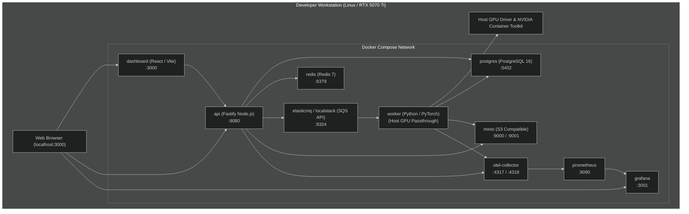
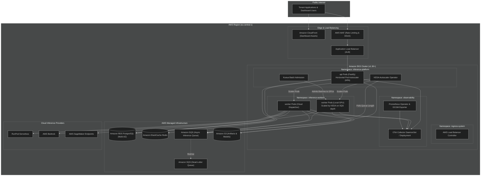

# Deployment Topology

This document details the physical and orchestration topologies for both local development and cloud production deployments of the **Multi-Tenant AI Inference Platform**.

---

## 1. Local Development Topology (Docker Compose)

The local environment provides full architectural fidelity without requiring active cloud credentials or paid managed services. All services run within Docker Compose, with optional hardware passthrough for host GPU acceleration.

### Local Dev Port Allocation

| Service | Internal Port | Host Port | Purpose |
|---|---|---|---|
| `dashboard` | 3000 | 3000 | React Product Dashboard |
| `api` | 8080 | 8080 | Fastify Control Plane API |
| `grafana` | 3000 | 3001 | Operational Monitoring Dashboards |
| `postgres` | 5432 | 5432 | Primary Relational Database |
| `redis` | 6379 | 6379 | Ephemeral State & Cache |
| `minio` | 9000, 9001 | 9000, 9001 | S3 API & MinIO Console |
| `elasticmq` | 9324 | 9324 | SQS-Compatible Message Queue |
| `prometheus` | 9090 | 9090 | Prometheus Metrics Storage |
| `otel-collector` | 4317, 4318 | 4317, 4318 | OTel gRPC / HTTP Ingestion |

---

## 2. Cloud Production Topology (AWS EKS & Managed Services)

The cloud production topology targets AWS using Amazon Elastic Kubernetes Service (EKS) managed with Terraform and reconciled via Argo CD. Stateless API and worker components run inside EKS, while stateful tiers rely on managed AWS infrastructure.

---

## 3. Kubernetes Autoscaling Architecture

The platform separates real-time API scaling from heavy batch/inference scaling (see [ADR-0008](../adr/0008-keda-and-kueue-workload-responsibilities.md)):

1. **Control Plane Scaling**:
   - `api` pods scale via standard Kubernetes Horizontal Pod Autoscaler ([`templates/api-hpa.yaml`](../../deploy/helm/inference-platform/templates/api-hpa.yaml)) based on CPU (`70%`) and memory (`80%`) utilization.
2. **Worker Queue-Depth Autoscaling (KEDA)**:
   - Inference workers scale from `0` to `maxReplicaCount` using KEDA ([`templates/keda-scaledobject.yaml`](../../deploy/helm/inference-platform/templates/keda-scaledobject.yaml)) measuring SQS queue depth (`ApproximateNumberOfMessagesVisible`) and Prometheus `queue_messages_visible`.
   - Enables rapid scale-out during batch bursts and scale-to-zero after `cooldownPeriod` when queues are idle to eliminate idle GPU compute spend.
3. **Batch Admission & Fair Sharing (Kueue)**:
   - Multi-tenant GPU quota sharing and priority queueing (`inference-realtime-high` > `inference-batch-standard` > `inference-batch-backfill`) are governed by Kueue ([`templates/kueue-admission.yaml`](../../deploy/helm/inference-platform/templates/kueue-admission.yaml)).
   - Prevents GPU out-of-memory (OOM) faults by creating batch `Job` workloads with `suspend: true` until `ClusterQueue` nominal or cohort-borrowed GPU quota is granted.

---

## 4. Helm Packaging, Profiles & Policy Governance (M06)

All Kubernetes resources are packaged in [`deploy/helm/inference-platform/`](../../deploy/helm/inference-platform/Chart.yaml) and validated via `make validate-k8s` ([`scripts/validate_kubernetes.py`](../../scripts/validate_kubernetes.py)):

| Artifact / Profile | Path | Purpose |
|---|---|---|
| **Local Kind Cluster** | [`deploy/kubernetes/kind-cluster.yaml`](../../deploy/kubernetes/kind-cluster.yaml) | 3-node local cluster topology (control-plane, CPU general worker node, and tainted GPU worker node). |
| **Default Values** | [`deploy/helm/inference-platform/values.yaml`](../../deploy/helm/inference-platform/values.yaml) | Baseline chart values for namespaces (`inference-platform`, `inference-workers`, `observability`), API, worker, KEDA, Kueue, and Kyverno. |
| **Local CPU Profile** | [`deploy/helm/inference-platform/values-local.yaml`](../../deploy/helm/inference-platform/values-local.yaml) | CPU-fallback worker profile (`nvidiaGpu: 0`, `NodePort: 30080`, `dcgmExporter.enabled: false`). |
| **GPU Node Profile** | [`deploy/helm/inference-platform/values-gpu.yaml`](../../deploy/helm/inference-platform/values-gpu.yaml) | GPU worker profile (`runtimeClassName: nvidia`, `nvidia.com/gpu: 1`, GPU nodeSelector/tolerations, and `dcgm-exporter` `DaemonSet` enabled). |
| **Kyverno Policies** | [`deploy/helm/inference-platform/templates/kyverno-policies.yaml`](../../deploy/helm/inference-platform/templates/kyverno-policies.yaml) | Enforces `require-non-root-and-drop-capabilities`, `require-workload-resource-bounds`, and `require-tenant-isolation-labels` (see [ADR-0011](../adr/0011-kyverno-admission-policy-enforcement.md)). |

