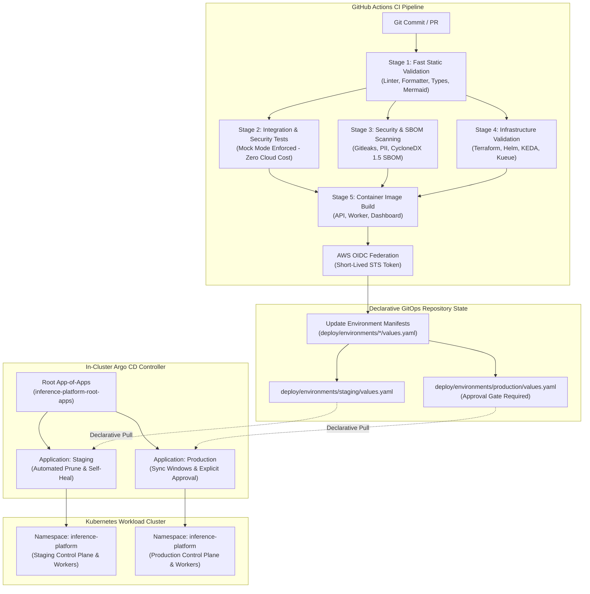
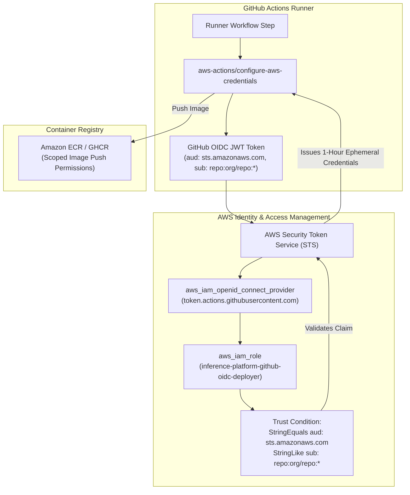
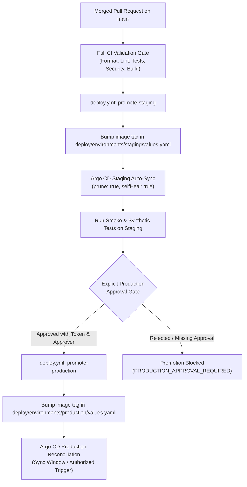

# GitOps, CI/CD & Software Supply Chain Architecture

This document specifies the software supply chain, federated cloud authentication, cost guardrails, and declarative GitOps continuous delivery architecture for the Multi-Tenant AI Inference Platform.

---

## 1. Architectural Overview & Separation of Concerns

In accordance with [ADR-0009](../adr/0009-argo-cd-gitops-reconciliation.md), the platform enforces an absolute boundary between Continuous Integration (CI) and Continuous Delivery (CD):

1. **Continuous Integration (GitHub Actions)**:
   - Validates code syntax, typing, and formatting.
   - Executes unit, contract, and multi-tenant security test suites under strict in-memory / mock execution to prevent unbudgeted cloud compute costs.
   - Scans for hardcoded secrets, PII, and generates CycloneDX 1.5 SBOMs.
   - Builds container images and publishes immutable image tags.
   - Authenticates to AWS via short-lived GitHub Actions OIDC federation (`sts:AssumeRoleWithWebIdentity`).
   - Updates versioned deployment configurations in Git (`deploy/environments/{staging,production}/values.yaml`).
2. **Continuous Delivery (Argo CD)**:
   - Runs in-cluster inside the Kubernetes control plane.
   - Treats Git repository branches as the sole single source of truth.
   - Continuously reconciles declared desired state against live cluster resources.
   - Automatically detects and self-heals configuration drift.
   - Manages progressive environment promotion from staging to production.



---

## 2. GitHub OIDC Federated AWS Authentication

The platform eliminates permanent AWS access keys (`AKIA...`) in CI runners. GitHub Actions assumes short-lived IAM roles via AWS Security Token Service (STS) using OpenID Connect (OIDC).



### Least-Privilege Trust Policy
The OIDC role trust policy explicitly limits assumption to the platform's specific repository and branches:

```json
{
  "Version": "2012-10-17",
  "Statement": [
    {
      "Sid": "GitHubActionsOIDCFederation",
      "Effect": "Allow",
      "Principal": {
        "Federated": "arn:aws:iam::000000000000:oidc-provider/token.actions.githubusercontent.com"
      },
      "Action": "sts:AssumeRoleWithWebIdentity",
      "Condition": {
        "StringEquals": {
          "token.actions.githubusercontent.com:aud": "sts.amazonaws.com"
        },
        "StringLike": {
          "token.actions.githubusercontent.com:sub": "repo:org/multi-tenant-AI-inference-platform:*"
        }
      }
    }
  ]
}
```

---

## 3. Declarative Argo CD Reconciler & App-of-Apps Pattern

Argo CD manages workloads through a root `Application` (the App-of-Apps pattern) that reconciles child applications and environment configurations:

1. **`AppProject` (`deploy/argocd/argocd-project.yaml`)**:
   - Bounds the security boundary of the platform.
   - Restricts destination server to `https://kubernetes.default.svc`.
   - Restricts destination namespaces to `inference-platform`, `inference-workers`, and `observability`.
   - Whitelists only approved Kubernetes resource kinds (Deployments, Services, ScaledObjects, ClusterQueues, Kyverno Policies).
2. **`Application: Staging` (`deploy/argocd/application-staging.yaml`)**:
   - Points to Helm values overlay `deploy/environments/staging/values.yaml`.
   - Enables automated synchronization with `prune: true` and `selfHeal: true`.
3. **`Application: Production` (`deploy/argocd/application-production.yaml`)**:
   - Points to Helm values overlay `deploy/environments/production/values.yaml`.
   - Disables unvetted automated synchronization (`manualSync: true`).
   - Declares strict maintenance sync windows and requires verified approver sign-off.
4. **`Application: Root` (`deploy/argocd/root-app-of-apps.yaml`)**:
   - Meta-orchestrates child applications in `deploy/argocd/`.

---

## 4. Cost Guardrails: Zero Unbudgeted Compute & Manual-Only Benchmarks

To avoid unnecessary cloud compute expenditure:
1. **Manual-Only Benchmarks**:
   - Benchmarks are triggered strictly on-demand via `workflow_dispatch` in `.github/workflows/benchmark.yml`.
   - Automated recurring cron schedules (`schedule:`) are prohibited and enforced by static analysis in `scripts/validate_gitops.py`.
2. **Zero Paid Cloud Inference in CI/CD**:
   - All tests in CI/CD run with `INFERENCE_MOCK_MODE=true`, `BEDROCK_MOCK=1`, `SAGEMAKER_MOCK=1`, and `RUNPOD_MOCK=1`.
   - The provider adapters (`BedrockAdapter`, `SageMakerAdapter`, `RunPodAdapter`) automatically default to mock execution when `CI=true` or `INFERENCE_MOCK_MODE=true` is set.
   - Local PyTorch testing runs in lightweight synthetic mode (`tier=1`, zero weight downloads).

---

## 5. Multi-Environment Promotion Model & Approval Gates

Environment promotion is strictly progressive:



### Invariant: Zero Imperative Kubernetes Bypass (Acceptance Criteria)

GitHub Actions runners possess **zero Kubernetes cluster administration credentials** (`KUBECONFIG`). The CI pipeline is strictly prohibited from running:
- `kubectl apply`, `kubectl create`, `kubectl patch`, or `kubectl delete`
- `helm install`, `helm upgrade`, or `helm rollback`

This invariant is verified both statically by `python scripts/validate_gitops.py --verify-no-bypass` in CI and dynamically by the control-plane API `GitOpsController` (`POST /v1/gitops/promote`), which rejects any request specifying `direct_cluster_apply: true` with HTTP 403 `GITOPS_BYPASS_PROHIBITED`.

---

## 6. Control Plane GitOps API Endpoints

The API control plane exposes programmatic inspection and governance of the GitOps pipeline:

| Method | Endpoint | Description |
|---|---|---|
| `GET` | `/v1/gitops/status` | Current reconciler health, OIDC role ARN, and active environments |
| `GET` | `/v1/gitops/environments` | Declared environments list, image tags, sync status, and policies |
| `GET` | `/v1/gitops/environments/:env` | Detailed specification for a specific environment |
| `POST` | `/v1/gitops/promote` | Promotes release to environment (enforces production approval gate) |
| `POST` | `/v1/gitops/sync/:env` | Triggers declarative Argo CD reconciliation cycle |

All endpoints produce Prometheus metrics (`gitops_status_inspections_total`, `gitops_promotions_total`, `gitops_sync_cycles_total`) and propagate W3C distributed trace context.

---

## 7. Local GitOps Verification & Interactive Argo CD Cluster

The repository supports two local-first verification modes with zero cloud compute cost:

### Method A: Static Offline Validation (Fast & Headless)
Runs without Kubernetes or container overhead to validate YAML schemas, Helm overlays, and CI bypass invariants:
```bash
make validate-gitops
# Or directly:
python scripts/validate_gitops.py
```

### Method B: Live Local Cluster with Argo CD UI (via Kind + Docker)
Spins up a local multi-node Kind cluster matching the platform node architecture, installs Argo CD, applies the GitOps project and application manifests, and provides live web UI access:
```bash
# Automated one-step setup:
make local-argocd
# Or run the script directly:
./scripts/setup_local_argocd.sh up

# Open Argo CD dashboard port-forward:
./scripts/setup_local_argocd.sh ui
# Access https://localhost:8080 (User: admin)

# Query initial admin password:
./scripts/setup_local_argocd.sh password

# Check cluster and application status:
./scripts/setup_local_argocd.sh status

# Tear down when finished:
./scripts/setup_local_argocd.sh down
```


