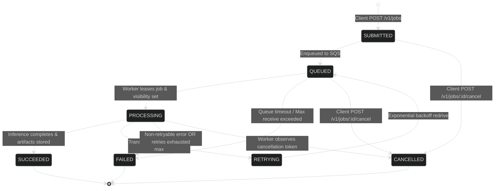
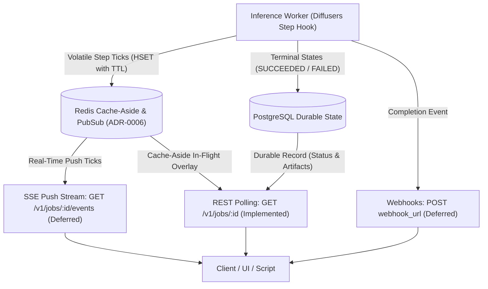

# API & Job Lifecycle Contract

This document formalizes the HTTP API contracts, asynchronous job lifecycle state machine, JSON schema payloads, idempotency rules, and failure semantics for the **Multi-Tenant AI Inference Platform**.

---

## 1. Job Lifecycle State Machine

An inference job transitions through well-defined lifecycle states. State mutations are monotonic and atomic.



### State Definitions

| State | Type | Description |
|---|---|---|
| `SUBMITTED` | Ephemeral | Received and validated by Control Plane API; written to PostgreSQL. |
| `QUEUED` | Active | Job envelope published to message broker; awaiting worker pickup. |
| `PROCESSING`| Active | Worker leased job, heartbeat active, model executing inference. |
| `RETRYING` | Active | Transient provider error; delayed backoff before re-queueing. |
| `SUCCEEDED` | Terminal | Execution completed; results and artifacts persisted in S3. |
| `FAILED` | Terminal | Permanent execution failure, invalid parameters, or exhausted retries. |
| `CANCELLED` | Terminal | Explicitly terminated by client request before or during execution. |

---

## 2. REST API Endpoints

All endpoints require authentication via Bearer token: `Authorization: Bearer <tenant_api_key>`.

### 2.1 Submit Inference Job
- **Method**: `POST /v1/jobs`
- **Headers**:
  - `Content-Type: application/json`
  - `Idempotency-Key: <unique-uuid-or-hash>` (Optional but recommended)
- **Status Codes**:
  - `202 Accepted`: Job accepted for asynchronous execution.
  - `200 OK`: Idempotent replay of an existing job submission.
  - `400 Bad Request`: Validation failure.
  - `401 Unauthorized`: Invalid or missing credentials.
  - `429 Too Many Requests`: Rate limit or concurrency quota exceeded.

#### Request Payload Schema
```json
{
  "$schema": "https://json-schema.org/draft/2020-12/schema",
  "title": "JobSubmissionRequest",
  "type": "object",
  "required": ["model_id", "input"],
  "properties": {
    "model_id": {
      "type": "string",
      "description": "Target model identifier (e.g., meta-llama/Llama-3-8B-Instruct, stable-diffusion-v1-5)"
    },
    "routing_preference": {
      "type": "string",
      "enum": ["auto", "mock", "local/cpu", "local/gpu", "local", "cloud", "cost_optimized", "low_latency", "local_first"],
      "default": "auto"
    },
    "priority": {
      "type": "integer",
      "minimum": 1,
      "maximum": 10,
      "default": 5
    },
    "input": {
      "type": "object",
      "description": "Inference input parameters. If >256KB, use presigned upload flow.",
      "properties": {
        "prompt": { "type": "string" },
        "parameters": {
          "type": "object",
          "properties": {
            "max_new_tokens": { "type": "integer", "default": 512 },
            "temperature": { "type": "number", "minimum": 0.0, "maximum": 2.0, "default": 0.7 },
            "top_p": { "type": "number", "minimum": 0.0, "maximum": 1.0, "default": 0.9 }
          }
        }
      },
      "required": ["prompt"]
    },
    "input_uri": {
      "type": "string",
      "format": "uri",
      "description": "S3 URI to presigned input blob if uploaded directly."
    }
  }
}
```

#### Response Payload (202 Accepted)
```json
{
  "job_id": "9b1deb4d-3b7d-4bad-9bdd-2b0d7b3dcb6d",
  "status": "QUEUED",
  "model_id": "meta-llama/Llama-3-8B-Instruct",
  "created_at": "2026-10-09T14:30:00Z",
  "poll_url": "/v1/jobs/9b1deb4d-3b7d-4bad-9bdd-2b0d7b3dcb6d"
}
```

---

### 2.2 Get Job Status & Result
- **Method**: `GET /v1/jobs/:id`
- **Response (200 OK - In-Flight Processing)**:
```json
{
  "job_id": "9b1deb4d-3b7d-4bad-9bdd-2b0d7b3dcb6d",
  "status": "PROCESSING",
  "model_id": "black-forest-labs/FLUX.1-schnell",
  "routing_preference": "local/gpu",
  "provider": "local_pytorch",
  "progress_pct": 75,
  "progress": {
    "phase": "denoising",
    "step": 3,
    "total_steps": 4,
    "percent": 75,
    "message": "Denoising step 3/4"
  },
  "created_at": "2026-10-09T14:30:00Z",
  "started_at": "2026-10-09T14:30:01Z"
}
```

- **Response (200 OK - Terminal Succeeded)**:
```json
{
  "job_id": "9b1deb4d-3b7d-4bad-9bdd-2b0d7b3dcb6d",
  "status": "SUCCEEDED",
  "model_id": "meta-llama/Llama-3-8B-Instruct",
  "provider": "local_pytorch",
  "progress_pct": 100,
  "progress": {
    "phase": "completed",
    "percent": 100
  },
  "created_at": "2026-10-09T14:30:00Z",
  "started_at": "2026-10-09T14:30:01Z",
  "completed_at": "2026-10-09T14:30:04Z",
  "duration_ms": 3120,
  "usage": {
    "prompt_tokens": 42,
    "completion_tokens": 128,
    "total_tokens": 170,
    "cost_microcents": 850
  },
  "result": {
    "output_text": "Antigravity is an AI pair programmer designed for rigorous software engineering.",
    "finish_reason": "stop"
  },
  "artifacts": [
    {
      "name": "full_output",
      "download_url": "https://storage.local/tenants/t-123/outputs/9b1deb4d.../result.json?expires=..."
    }
  ]
}
```

---

### 2.3 Cancel In-Flight Job
- **Method**: `POST /v1/jobs/:id/cancel`
- **Status Codes**:
  - `200 OK`: Job marked cancelled.
  - `409 Conflict`: Cannot cancel job in terminal state (`SUCCEEDED`, `FAILED`).

---

## 3. Idempotency Contract

Clients pass `Idempotency-Key` headers on job creation.
1. The Control Plane checks PostgreSQL / Redis for an existing record with matching `(tenant_id, idempotency_key)`.
2. If found within the 24-hour deduplication window:
   - Returns the existing `job_id` and status with HTTP `200 OK`.
   - Does not enqueue a duplicate task to the message broker.
3. If not found:
   - Persists the record and returns HTTP `202 Accepted`.

---

## 4. Uniform Error Responses (RFC 7807)

All non-2xx responses conform to RFC 7807:

```json
{
  "type": "https://api.platform.local/errors/quota-exceeded",
  "title": "Tenant Quota Exceeded",
  "status": 429,
  "detail": "Tenant 'acme-corp' has exceeded its monthly token limit of 10,000,000 tokens.",
  "instance": "/v1/jobs",
  "code": "TENANT_QUOTA_EXCEEDED",
  "timestamp": "2026-10-09T14:30:00Z"
}
```

---

## 5. Interactive Testing Cycles (`request.rest`)

To test the API interactively, the repository maintains an executable REST scratchpad in [`request.rest`](../../request.rest) organized into five sequential, self-contained Use Case Cycles:

| Cycle | Purpose | Request Sequence | Expected Lifecycle Mutations |
|---|---|---|---|
| **1. Health & Dependency Check** | Validates liveness and subsystem readiness | `GET /healthz` → `GET /readyz` | None (reads DB, S3, SQS health status) |
| **2. Happy Path Lifecycle** | Simulates full successful async execution | `POST /v1/jobs` → `GET /v1/jobs/:id` → `POST /v1/jobs/:id/transition` (PROCESSING) → `POST /v1/jobs/:id/transition` (SUCCEEDED) → `GET /v1/jobs/:id` | `QUEUED` → `PROCESSING` → `SUCCEEDED` (presigned S3 artifact URLs attached) |
| **3. Idempotent Deduplication** | Verifies duplicate prevention | `POST /v1/jobs` (Idempotency-Key) → `POST /v1/jobs` (same key) → `GET /v1/jobs/:id` | Initial returns `202 Accepted`; replay returns `200 OK` with identical `job_id` |
| **4. Job Cancellation** | Verifies client-directed abort and terminal conflict protection | `POST /v1/jobs` → `POST /v1/jobs/:id/cancel` → `GET /v1/jobs/:id` → `POST /v1/jobs/:id/cancel` (conflict attempt) | `QUEUED` → `CANCELLED`; second cancel attempt returns `409 Conflict` |
| **5. RFC 7807 Error Handling** | Verifies structured Problem Details errors | Invalid `POST /v1/jobs` → Non-existent `GET /v1/jobs/:id` | `400 Bad Request` (validation issues) and `404 Not Found` Problem Details |
| **6. Worker, Retries & DLQ** | Verifies worker execution, transient backoff retries, and DLQ quarantine | `POST /v1/jobs` → `POST /v1/worker/process-next` → `GET /v1/jobs/:id` → `GET /v1/jobs/dlq` | `QUEUED` → `PROCESSING` → `RETRYING` / `FAILED` (quarantined in DLQ) |

---

## 6. Progress Reporting & Future Streaming Improvements

### 6.1 Implemented: REST Polling Progress (`GET /v1/jobs/:id`)
Long-running generative inference (diffusion denoising, large language models) reports real-time progress through monotonic step milestones exposed directly on `GET /v1/jobs/:id`:
* **`progress_pct`**: An integer scalar ($0 \to 100$) for simple progress bar rendering in client UIs.
* **`progress`**: Structured lifecycle phase metadata:
  ```json
  {
    "phase": "loading_model" | "denoising" | "generating" | "encoding_artifact" | "completed" | "failed",
    "step": 2,
    "total_steps": 4,
    "percent": 50,
    "message": "Denoising step 2/4"
  }
  ```
The worker hooks into PyTorch/`diffusers` step callbacks (`callback_on_step_end`), streaming progress ticks into the database while throttling high-frequency disk I/O.

### 6.2 Architectural Improvements (Roadmap / Deferred)



1. **In-Memory Cache-Aside Pattern (Redis / Valkey)**:
   * **Separation of Concerns**: In accordance with [ADR-0006](../adr/0006-redis-scoped-coordination.md), PostgreSQL remains the durable source of truth for permanent lifecycle states (`QUEUED`, `SUCCEEDED`, `FAILED`, `CANCELLED`).
   * **Volatile Progress Keys**: Sub-second in-flight denoising progress ticks are written directly to Redis (`HSET job:{id}:progress` with a 10-minute TTL).
   * **Cache-Aside REST Overlay**: When `GET /v1/jobs/:id` is invoked, the API reads the job envelope from PostgreSQL and transparently overlays live progress from Redis if the job is `PROCESSING`, preventing database disk write contention under thousands of concurrent inference steps.
2. **Server-Sent Events (SSE) Push Stream (`GET /v1/jobs/:id/events`)**:
   * For interactive web dashboards and frontends needing sub-second push updates without polling overhead.
   * Transmits `text/event-stream` chunks (`event: progress`, `event: completed`).
3. **Out-of-Band Webhooks (`webhook_url`)**:
   * For backend-to-backend orchestrators (e.g., Flyte DAGs or enterprise workflow engines), permitting zero-polling notification when long batch jobs reach terminal state.


