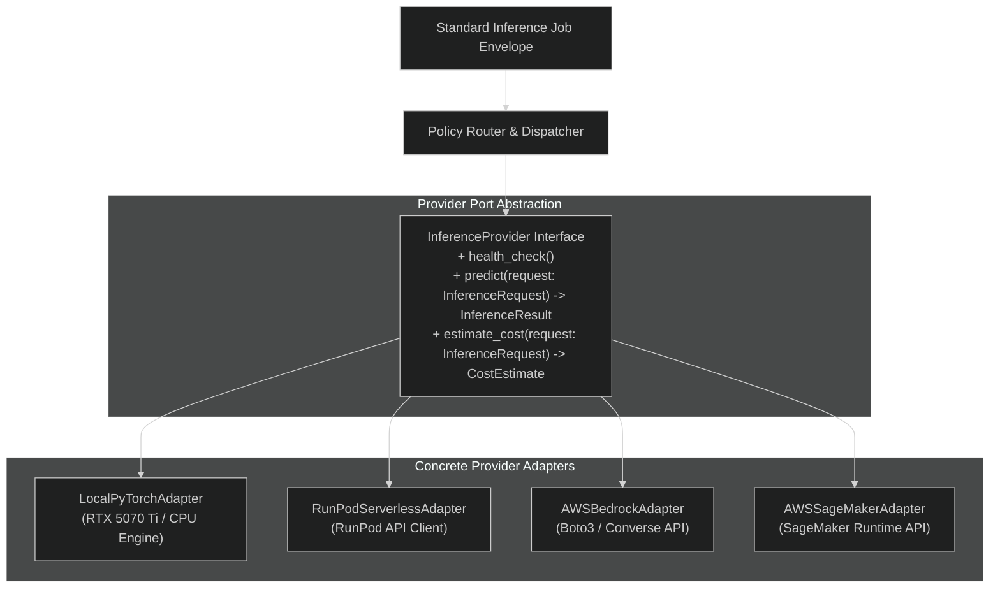
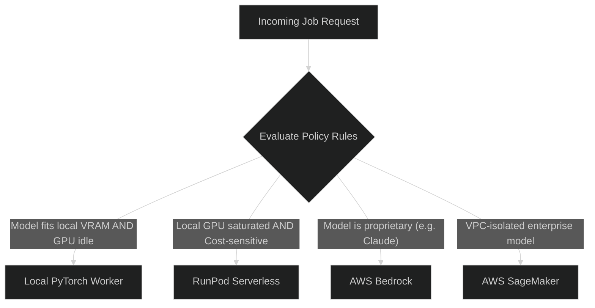
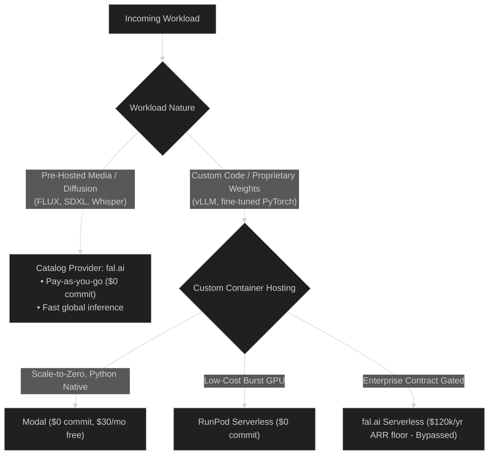
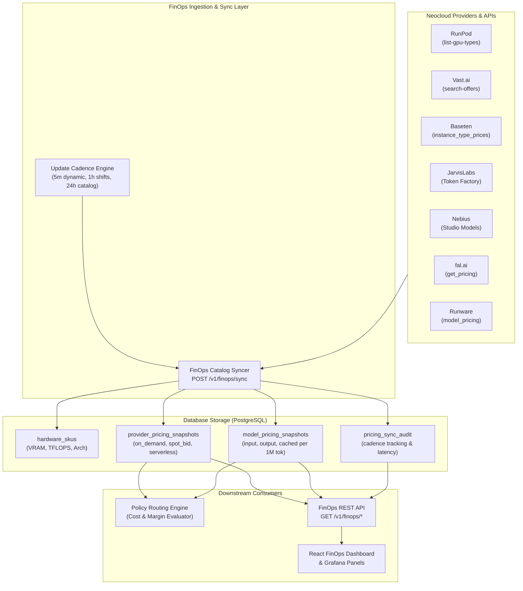

# Provider Abstraction & Adapter Architecture

This document defines the provider-agnostic port interface and adapter contracts enabling the **Multi-Tenant AI Inference Platform** to dispatch workloads interchangeably between local compute and cloud inference backends.

---

## 1. Architectural Motivation

A key tenet of the platform is **Provider-Agnostic Core**:
- High-level business logic (tenancy, billing, queue lifecycle, state transitions) must never bind directly to proprietary cloud SDKs (AWS Bedrock, SageMaker, or RunPod).
- Local execution (on developer workstations or on-premise RTX 5070 Ti GPUs) and cloud execution share identical interface contracts and telemetry signatures.



---

## 2. Standard Interface Definition

All backend adapters implement the `InferenceProvider` abstract base class (Python) or interface (TypeScript):

```python
from abc import ABC, abstractmethod
from typing import AsyncIterator, Optional
from pydantic import BaseModel


class InferenceRequest(BaseModel):
    job_id: str
    tenant_id: str
    model_id: str
    prompt: str
    parameters: dict
    stream: bool = False
    timeout_seconds: float = 300.0


class UsageMetrics(BaseModel):
    prompt_tokens: int
    completion_tokens: int
    total_tokens: int
    compute_duration_ms: float
    estimated_cost_microcents: int


class InferenceResult(BaseModel):
    output_text: str
    finish_reason: str
    usage: UsageMetrics
    provider_name: str
    raw_provider_response: Optional[dict] = None


class InferenceProvider(ABC):
    @property
    @abstractmethod
    def name(self) -> str:
        """Provider identifier: 'local_pytorch', 'runpod', 'bedrock', 'sagemaker'."""
        pass

    @abstractmethod
    async def is_healthy(self) -> bool:
        """Verify provider availability and connectivity."""
        pass

    @abstractmethod
    async def predict(self, request: InferenceRequest) -> InferenceResult:
        """Execute inference synchronously or wait on remote invocation."""
        pass

    @abstractmethod
    async def estimate_cost(self, request: InferenceRequest) -> int:
        """Return projected cost in microcents (1/10,000 cent) before dispatch."""
        pass
```

---

## 3. Concrete Adapters

### 3.1 Local PyTorch Adapter (`local_pytorch`)
- **Execution Target**: Dedicated worker process with direct CUDA / ROCm access or CPU fallback.
- **Model Loading**: Hugging Face Transformers, `vLLM` / `torch.compile` optimization, 4-bit / 8-bit quantized models (`bitsandbytes` / `AWQ`).
- **Telemetry**: Measures exact VRAM allocations via PyTorch CUDA APIs and tokens-per-second throughput.

### 3.2 RunPod Serverless Adapter (`runpod`)
- **Execution Target**: RunPod Serverless REST API endpoint.
- **Characteristics**: Low cold-start overhead for burst GPU compute; costs billed per active GPU-second.
- **Error Handling**: Detects queue timeout (`HTTP 408`) and automatically triggers retry or fallback.

### 3.3 AWS Bedrock Adapter (`bedrock`)
- **Execution Target**: Amazon Bedrock Foundation Models (Claude, Llama 3, Titan).
- **Billing Model**: Pure token-based billing (prompt tokens + completion tokens).
- **Authentication**: AWS IAM SigV4 via EKS IAM Roles for Service Accounts (IRSA).

### 3.4 AWS SageMaker Adapter (`sagemaker`)
- **Execution Target**: Amazon SageMaker Real-Time or Asynchronous Endpoints.
- **Characteristics**: Suitable for custom proprietary weights hosted within customer VPCs.

---

## 4. Policy-Based Routing

The routing engine dynamically selects the optimal adapter based on job criteria and tenant tier:



### Routing Strategies
- **`local_first` (Default)**: Attempts local execution on RTX 5070 Ti / local cluster. If VRAM is full or queue backlog exceeds threshold, overflows to RunPod.
- **`cost_optimized`**: Prefers lowest unit cost per 1k tokens among available healthy providers.
- **`low_latency`**: Routes to warmed endpoints with zero cold start.
- **`tenant_pinned`**: Enforces strict routing policies configured per tenant (e.g., enterprise data isolation constraints forbidding external cloud APIs).

---

## 5. Evaluated & Deferred Providers

Brief evaluation log of alternative compute and inference clouds, tracking why they are deferred for current platform phases and the triggers to reconsider them.

### 5.1 Lambda Labs (`lambda.ai`)
- **Profile**: High-performance enterprise GPU cloud (H100, A100, GH200) + pay-per-token Inference API for standard open LLMs.
- **Cost Advantage**: Highly competitive on-demand VM rates (~60–75% cheaper than equivalent AWS EC2 `p5`/`p4` instances).
- **Why Deferred Now**:
  - **No Scale-to-Zero for Custom Workloads**: Does not support serverless custom container deployments; requires paying continuously for dedicated VMs.
  - **Billing & Account Friction**: Unified billing enforces post-paid credit card validation (blocking prepaid/debit cards), posing runaway cost risks for unmonitored idle instances.
  - **Current Traffic Profile**: Without steady, round-the-clock traffic data, paying ~\$1.29–\$2.49/hr for idle/intermittent GPU instances is cost-inefficient compared to serverless micro-billing.
- **Revisit Trigger**: Baseline traffic reaches steady, 24/7 high-volume saturation where dedicated vLLM / Triton clusters yield lower per-token cost than serverless providers.

### 5.2 Dedicated / Bare-Metal Neoclouds (TensorDock, JarvisLabs, NeoCloudz)
- **Profile**: Unmanaged/managed VM and bare-metal GPU rentals.
- **Why Deferred Now**: Lack scale-to-zero serverless endpoint abstractions and dynamic workload auto-scaling.
- **Revisit Trigger**: Long-running model fine-tuning batches, multi-node distributed training, or dedicated static tenant infrastructure.

### 5.3 Candidate Serverless Neoclouds & Commercial Gating Trade-Offs

When expanding serverless adapters beyond RunPod, the platform evaluates neoclouds along two dimensions: execution semantics (scale-to-zero, cold starts) and commercial barriers (minimum spend, self-serve access).



#### Real-World Case Study: Split-Routing vs. Enterprise Gating (fal.ai vs. Modal/RunPod)
A key architectural justification for provider abstraction is insulating the platform from provider commercial gating:
- **fal.ai Split Reality**:
  - **Pre-Hosted Model APIs**: Exceptional cost-efficiency and latency for standardized diffusion/audio models (e.g., FLUX.1 [schnell] at \$0.003/megapixel, Whisper at \$0.066/audio hr). Entirely self-serve with zero minimum spend.
  - **Custom Serverless Compute (`fal.App`)**: Imposes an enterprise qualification threshold of **\$120,000/year ARR minimum commitment**, preventing solo developers and agile teams from benchmarking custom container workloads without enterprise contracts.
- **Platform Resolution (Split-Routing Architecture)**:
  - The platform implements **transparent split-routing**: catalog media tasks route to fal.ai's pay-per-call endpoints, while custom PyTorch/Docker workloads route to **Modal** or **RunPod Serverless** where scale-to-zero carries \$0 commitment.
  - This architecture avoids both premature \$120k enterprise lock-in and vendor-specific operational friction.

#### Summary of Evaluated Neoclouds
- **Modal**: Python-native serverless containers, sub-second cold starts, \$30/month free developer tier, zero commitment. Ideal for custom microservices.
- **Baseten**: Production-grade model serving using Truss packaging, vLLM acceleration, cold-start caching, and developer pay-as-you-go tier.
- **fal.ai**: Specialized ultra-low latency infrastructure for pre-hosted generative media and diffusion pipelines.
- **Nebius AI Studio / Cloud**: High-throughput shared token APIs (Studio) alongside sovereign dedicated GPU clusters (Cloud) with native InfiniBand fabrics.

### 5.4 Radiant (`radiant.co`)
- **Profile**: Vertically integrated utility-scale AI infrastructure platform (Ori Industries + Brookfield); bare-metal GPU clusters, private AI factories, and managed Slurm/K8s.
- **Why Deferred Now**:
  - **No Self-Service Developer Registration**: Public sign-up is gated behind sales qualification. The `/sign-up` route (`radiant.co/sign-up`) embeds a HubSpot lead capture form ("Let's Build Big") rather than automated account creation.
  - **Pre-Provisioned Console Access**: The developer console (`console.radiant.co` / `login.ogc.ori.co`) routes through Auth0 with GitHub OAuth, but blocks unwhitelisted organizations without prior contractual onboarding.
- **Revisit Trigger**: Enterprise multi-rack or sovereign cluster contracts, private datacenter infrastructure requirements, or if Radiant launches a self-serve developer tier.

### 5.5 Koyeb / Mistral Compute (`koyeb.com` — Acquired / In Transition)
- **Profile**: Serverless container and GPU microVM platform acquired by Mistral AI in February 2026 to form the foundation of **Mistral Compute** (serverless inference, AI agent sandboxes, and low-latency European infrastructure).
- **Acquisition & Transition Status**:
  - Mistral AI entered a definitive agreement to acquire Koyeb to build out vertical cloud compute capabilities beneath its frontier model layer.
  - **Dashboard Gating (`app.koyeb.com`)**: During the platform transition to Mistral Compute, Koyeb removed unverified and card-free onboarding tiers to mitigate bot abuse. New accounts cannot generate API keys, inspect live GPU inventory, or view serverless pricing without submitting a verified credit card (with pre-authorization hold) and upgrading from the default unverified organization tier.
- **Why Deferred for Custom BYOM Serverless Now**:
  - **No General BYOM on Mistral API**: Mistral's developer console (`console.mistral.ai`) operates strictly as Model-as-a-Service (MaaS) for the Mistral model family and fine-tuned checkpoints; it does not support arbitrary custom container/weights upload or arbitrary GPU hardware selection.
  - **Console Friction**: Public self-service deployment of custom Docker containers with scale-to-zero GPU selection on Koyeb is currently gated pending the unified Mistral Compute rollout.
  - **Existing Coverage**: The platform already covers scale-to-zero serverless GPU execution for custom models via **RunPod Serverless** and **Beam Cloud**, and covers Mistral models directly via **AWS Bedrock** and the local PyTorch engine.
- **Revisit Trigger**: Public general availability of **Mistral Compute** serverless container and GPU primitives with automated self-service developer onboarding, or official release of native Mistral agent sandboxes.

---

## 6. FinOps Neocloud Pricing & Availability Intelligence

To maximize gross margins and avoid high cloud commitments, the platform tracks real-time GPU availability, spot rates, and open model token pricing across neocloud providers.



### 6.1 Database Schema for Pricing Intelligence
Defined in `apps/api/src/infrastructure/db/migrations/006_finops_pricing_and_interruptions.sql`:
- **`hardware_skus`**: Normalized GPU hardware definitions (`nvidia-rtx-5090`, `nvidia-rtx-5070-ti`, `nvidia-rtx-4090`, `nvidia-l4`, `nvidia-l40s`, `nvidia-a10g`, `nvidia-a100-80gb-sxm`, `nvidia-h100-sxm5`) tracking VRAM capacity, FP16/BF16 compute TFLOPS, and architecture generation.
- **`provider_pricing_snapshots`**: Spot, on-demand, and serverless price tracking with microcents precision, normalized hourly rates in USD, obtainability score (`0.0`–`1.0`), and interruption risk tiers (`LOW`, `MEDIUM`, `HIGH`). All tracked offerings require **\$0 long-term commitments** (pure pay-as-you-go).
- **`model_pricing_snapshots`**: Open model rates for Token Factory and serverless inference, tracking input, output, and cached prompt discounts per 1M tokens, or per-unit costs (megapixels, audio seconds).
- **`pricing_sync_audit`**: Records update frequency and synchronization latencies, categorizing providers into dynamic auction updates (e.g. Vast.ai every 5m), hourly spot shifts (RunPod), and scheduled catalog changes (Baseten, JarvisLabs).


