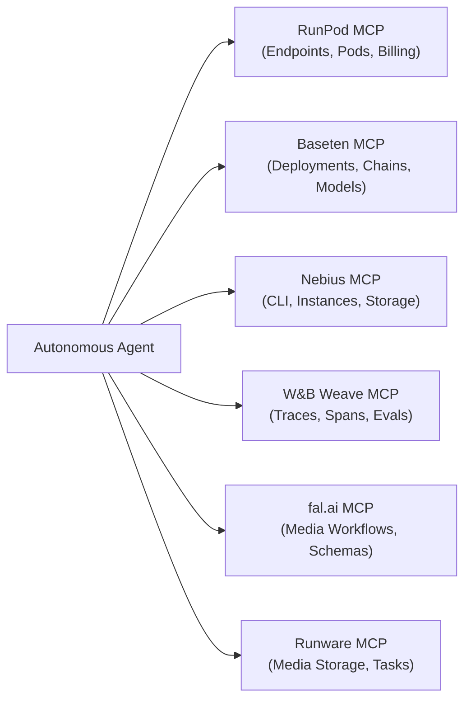

# Enterprise Developer & Agent Environment Guide

This guide establishes the standardized enterprise operational framework for configuring, reproducing, and operating the local and cloud development environment across **hyperscalers**, **neoclouds**, and **autonomous AI coding agents**.

---

## 1. Enterprise Three-Tier Inference & Agent Architecture

The platform partitions compute and agent capabilities into three distinct tiers:

```mermaid
flowchart TD
    subgraph AgentLayer["Autonomous Agent & Developer Layer"]
        Agents["AI Agents & IDEs\n(Antigravity / Claude / Cursor)"]
        MCPGateway["Model Context Protocol (MCP)\n(.mcp.json / ~/.gemini/config)"]
        Agents --> MCPGateway
    end

    subgraph PlatformControlPlane["Platform Gateway & Routing Core"]
        FastifyAPI["Fastify Control Plane (API)"]
        PolicyEngine["Deterministic Routing Policy"]
        FastifyAPI --> PolicyEngine
    end

    subgraph Tier1["Tier 1: Local Workstation Hardware (Zero Cost)"]
        LocalGPU["Local PyTorch CUDA Worker\n(NVIDIA GeForce RTX 5070 Ti / CPU)"]
    end

    subgraph Tier2["Tier 2: Hyperscalers (Compliance & VPC Isolation)"]
        Bedrock["AWS Bedrock (Converse API / Claude 3)"]
        SageMaker["AWS SageMaker (VPC Endpoints / JumpStart)"]
    end

    subgraph Tier3["Tier 3: Neoclouds & Specialized GPU Providers (Elastic Burst)"]
        NeoCloudz["NeoCloudz (DigiPowerX B200/OpenAI Gateway)"]
        RunPod["RunPod Serverless GPU (vLLM / A100)"]
        Nebius["Nebius AI Studio & Cloud (European Sovereign)"]
        Baseten["Baseten (Truss / vLLM Serverless)"]
        Modal["Modal (Scale-to-Zero Python GPU)"]
        Fal["fal.ai (Diffusion & Media Pipelines)"]
        WandB["Weights & Biases (Weave Tracing & Registry)"]
        Runware["Runware (Fast Inference Engine)"]
        CoreWeave["CoreWeave Forge (Sandboxes & Inference)"]
        JarvisLabs["JarvisLabs (Token Factory & Serverless)"]
        Beam["Beam Cloud (Serverless GPU Containers)"]
        Hivenet["Hivenet (Distributed GPU Compute)"]
        WaveSpeed["WaveSpeed AI (Foundation Model Gateway)"]
        Vast["Vast.ai (Consumer GPU Marketplace)"]
    end

    MCPGateway -.->|"Infrastructure Control"| RunPod & Baseten & Nebius & WandB & Fal & Runware
    PolicyEngine -->|"Queue Low + VRAM Free"| LocalGPU
    PolicyEngine -->|"VPC & Enterprise Compliance"| Tier2
    PolicyEngine -->|"SLO Risk / Elastic GPU Burst"| Tier3
```



---

## 2. One-Command Enterprise Bootstrap

Any developer or automated CI runner cloning this repository can reproduce the complete environment with a single command:

```bash
make setup-dev
```

This single command deterministically executes:
1. `make init`: Initializes `.venv`, configures repository-local `pnpm` via Corepack, installs PyTorch CUDA dependencies, and builds TypeScript packages.
2. `make setup-mcp`: Reads local provider keys and generates `.mcp.json` (workspace), `.mcp.example.json` (sanitized template), and synchronizes user agent configurations (`~/.gemini/config/mcp_config.json`).
3. `make check-providers`: Validates hardware acceleration (RTX 5070 Ti / CUDA) and tests connectivity to all 17 providers.
4. `make install-hooks`: Activates local Git pre-commit hooks ensuring zero secrets or PII are ever committed.

---

## 3. Standardized Provider Configuration (`BASE_URL` & Unique `MOCK_PROVIDERS` Flag)

All external cloud providers operate under a **unique global mock flag**:
- `MOCK_PROVIDERS=1` (or `MOCK_INFERENCE=1`): Safe offline simulation across all remote cloud adapters (zero cloud billing).
- `MOCK_PROVIDERS=0` (or `MOCK_INFERENCE=0`): Live remote execution using configured credentials and `BASE_URL`s.
- *Local PyTorch CUDA / RTX 5070 Ti always executes live on local hardware.*

All 17 inference providers and platforms share explicit, standardized `BASE_URL` variables configured in `.env` (with sanitized templates in `.env.providers.example`):

| Provider | Category | Standard Base URL | Primary Auth Variable |
|---|---|---|---|
| **Local PyTorch** | Local Hardware | `http://localhost:8000/v1` | Auto-detected (RTX 5070 Ti / CPU) |
| **AWS Bedrock** | Hyperscaler | `https://bedrock-runtime.us-east-1.amazonaws.com` | `AWS_ACCESS_KEY_ID` / IAM IRSA |
| **AWS SageMaker** | Hyperscaler | `https://runtime.sagemaker.us-east-1.amazonaws.com` | `SAGEMAKER_ENDPOINT_NAME` |
| **NeoCloudz** | Neocloud Gateway | `https://console.neocloudz.com/gateway/v1` | `NEOCLOUDZ_API_KEY` (JWT) |
| **RunPod** | Neocloud Serverless | `https://api.runpod.ai/v2` | `RUNPOD_API_KEY` |
| **Nebius AI Studio** | Sovereign AI Cloud | `https://api.studio.nebius.ai/v1` | `NEBIUS_API_KEY` |
| **Nebius AI Cloud** | Dedicated Cloud | `https://<endpoint-id>.ai.nebius.cloud` | `NEBIUS_ENDPOINT_TOKEN` |
| **Baseten** | Neocloud Serverless | `https://bridge.baseten.co/v1` | `BASETEN_API_KEY` |
| **fal.ai** | Media & Diffusion | `https://rest.alpha.fal.ai` | `FAL_KEY` |
| **Runware** | Fast Inference Engine | `https://api.runware.ai/v1` | `RUNWARE_API_KEY` |
| **CoreWeave Forge** | Neocloud Sandboxes | `https://api.inference.wandb.ai/v1` | `COREWEAVE_FORGE_API_KEY` |
| **Weights & Biases** | Weave & Model Registry| `https://api.wandb.ai` | `WANDB_API_KEY` |
| **Modal** | Serverless Python GPU | `https://api.modal.com` | `MODAL_TOKEN_ID` |
| **JarvisLabs** | Token Factory | `https://models.jarvislabs.net/v1` | `JL_API_KEY` |
| **Beam Cloud** | Serverless GPU | `https://api.beam.cloud/v1` | `BEAM_TOKEN` |
| **Hivenet** | Distributed Cloud | `https://api.hivecompute.ai/v1` | `HIVENET_API_KEY` |
| **WaveSpeed AI** | Multi-Modal Gateway | `https://api.wavespeed.ai` | `WAVESPEED_API_KEY` |
| **Vast.ai** | GPU Marketplace | `https://console.vast.ai/api/v0` | `VAST_API_KEY` |

---

## 4. Model Context Protocol (MCP) Multi-Agent Integration

The Model Context Protocol (MCP) gives autonomous AI coding agents tools to inspect, monitor, configure, and execute tasks across the cloud inference stack.

### 4.1 Replicating MCP Setup on Any Machine

To replicate the MCP setup on a fresh machine or codespace:
```bash
# 1. Ensure your .env contains your active provider keys (or use placeholders)
# 2. Run automated synchronization
make setup-mcp
```

This generates:
- `.mcp.json` at repository root: Used by Cursor, Claude Code, and VS Code MCP clients.
- `~/.gemini/config/mcp_config.json`: Automatically updates Google Antigravity / Gemini CLI with all active tools.
- `.mcp.example.json`: Sanitized, committed reference template.

### 4.2 Available MCP Servers & Capabilities



1. **`runpod`**: Manage serverless GPU endpoints, check capacity, stream worker logs, and inspect billing (`https://mcp.runpod.io/`).
2. **`baseten`**: Manage Truss deployments, inspect model chainlets, and tune autoscaling (`https://api.baseten.co/mcp`).
3. **`nebius`**: Sovereign GPU cluster management, service profiles, and sandboxed CLI execution (`uvx nebius-mcp-server`).
4. **`wandb`**: Query Weave traces, resolve agent execution spans, and evaluate model benchmarks (`https://mcp.withwandb.com/mcp`).
5. **`fal`**: Search diffusion model schemas, submit media jobs, and monitor workflows (`https://mcp.fal.ai/mcp-relay`).
6. **`runware`**: Fast image generation, media storage, and task status polling (`npx @runware/mcp`).

---

## 5. Consuming Neoclouds & Hyperscalers in Enterprise Agents

### 5.1 Neoclouds with OpenAI-Compatible Interfaces (e.g. NeoCloudz)

NeoCloudz provides high-throughput inference running on DigiPowerX bare-metal GPU clusters with full function calling support:

```python
from openai import OpenAI
import os

client = OpenAI(
    api_key=os.environ.get("NEOCLOUDZ_API_KEY"),
    base_url=os.environ.get("NEOCLOUDZ_BASE_URL", "https://console.neocloudz.com/gateway/v1"),
)

response = client.chat.completions.create(
    model="DigiPowerX/Qwen/Qwen3.8-27B",
    messages=[{"role": "user", "content": "Analyze pipeline throughput"}],
    tools=[...],  # Full MCP tool bridging supported
)
```

### 5.2 Hyperscalers via Managed SDKs (AWS Bedrock & SageMaker)

Hyperscalers leverage standard AWS credentials or IAM Roles for Service Accounts (IRSA) in EKS:

```python
import boto3

bedrock = boto3.client("bedrock-runtime", region_name="us-east-1")
response = bedrock.converse(
    modelId="anthropic.claude-3-sonnet-20240229-v1:0",
    messages=[{"role": "user", "content": [{"text": "Summarize batch job"}]}],
)
```

---

## 6. Security & Safe Mock Invariants

1. **Zero Secret Leakage**:
   - `.env` and `.mcp.json` are strictly ignored by `.gitignore`.
   - `scripts/check_secrets_pii.py` and Gitleaks enforce 0 leaks in local CI.
2. **Deterministic Offline Testing**:
   - `MOCK_INFERENCE=1` is strictly enforced during unit and integration test suites.
   - Cloud provider adapters return realistic simulated payloads with zero billable cloud requests during CI.
3. **Production Secret Injection**:
   - In Kubernetes, credentials are mounted from AWS Secrets Manager via External Secrets Operator or HashiCorp Vault.

