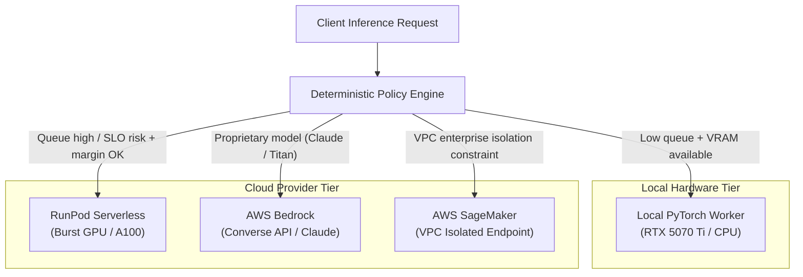

# Inference Provider Setup & Operational Guide

This guide describes how to configure, authenticate, automate, and verify both local and cloud inference providers within the **Multi-Tenant AI Inference Platform**:
- **Local PyTorch / CUDA Engine** (RTX 5070 Ti / CPU fallback)
- **RunPod Serverless GPU** (Dynamic burst capacity)
- **AWS Bedrock** (Managed foundation models via Converse API)
- **AWS SageMaker** (Dedicated / VPC-isolated endpoints)

---

## 1. Provider Architecture & Routing Role

The platform utilizes a provider-agnostic port interface (`InferenceProvider`), allowing high-level tenant workloads to route dynamically between on-premise hardware and external cloud compute based on measurable constraints:



---

## 2. Automated Provider Setup & Diagnostics

The repository provides an automated verification script at `scripts/setup_providers.py`.

### 2.1 Diagnostics Check
Run diagnostics to verify hardware detection, active environment variables, and adapter readiness:
```bash
python3 scripts/setup_providers.py --check
```

### 2.2 Generate Sanitized Environment Template
Generate a sanitized `.env.providers.example` file:
```bash
python3 scripts/setup_providers.py --generate-env
```

### 2.3 Test Prediction Across Providers
Execute a test inference job directly through any provider adapter (in live or mock mode):
```bash
python3 scripts/setup_providers.py --test-prediction --provider local_pytorch
python3 scripts/setup_providers.py --test-prediction --provider runpod
python3 scripts/setup_providers.py --test-prediction --provider bedrock
python3 scripts/setup_providers.py --test-prediction --provider sagemaker
```

---

## 3. How to Activate Live Calls (De-mocking)

The platform defaults external cloud adapters to **safe mock mode** (`MOCK_INFERENCE=1`, or `ENABLE`/`TRUE`) so that developers and CI suites can run full lifecycle tests offline without incurring paid cloud compute bills. Testing environments strictly enforce mock inference (`ENABLE/TRUE/1`); **no real inference in test is allowed**.

> [!IMPORTANT]
> **Local PyTorch is ALWAYS Live**: The `local_pytorch` adapter runs real neural network forward passes directly on your local GPU (e.g. NVIDIA GeForce RTX 5070 Ti) using PyTorch CUDA tensors without any mocking.

To activate live remote cloud execution for RunPod, AWS Bedrock, AWS SageMaker, or any configured neocloud:

### 3.1 Live Activation Variables

| Provider | Mock Variable | Required Live Credentials / Settings | Verification Command |
|---|---|---|---|
| **Local PyTorch** | *None (Always Live)* | `LOCAL_INFERENCE_DEVICE=auto` | `python3 scripts/setup_providers.py --test-prediction --provider local_pytorch` |
| **RunPod Serverless** | `MOCK_INFERENCE=0` | `RUNPOD_API_KEY="rpa_..."`<br>`RUNPOD_ENDPOINT_ID="vllm-..."` | `python3 scripts/setup_providers.py --test-prediction --provider runpod` |
| **AWS Bedrock** | `MOCK_INFERENCE=0` | `AWS_REGION="us-east-1"`<br>`AWS_ACCESS_KEY_ID="AKIA..."`<br>`AWS_SECRET_ACCESS_KEY="..."` | `python3 scripts/setup_providers.py --test-prediction --provider bedrock` |
| **AWS SageMaker** | `MOCK_INFERENCE=0` | `AWS_REGION="us-east-1"`<br>`SAGEMAKER_ENDPOINT_NAME="..."`<br>AWS credentials (or IAM IRSA in EKS) | `python3 scripts/setup_providers.py --test-prediction --provider sagemaker` |

### 3.2 Quick Live Activation Example
Run in your shell or set in your local environment:
```bash
# 0. Globally deactivate mock mode for live inference across all providers
export MOCK_INFERENCE=0

# 1. Configure RunPod Serverless credentials
export RUNPOD_API_KEY="rpa_your_live_runpod_api_key"
export RUNPOD_ENDPOINT_ID="vllm-llama3-8b-endpoint-id"

# 2. Configure AWS Bedrock Converse API credentials
export AWS_REGION="us-east-1"
export AWS_ACCESS_KEY_ID="AKIA_YOUR_AWS_KEY"
export AWS_SECRET_ACCESS_KEY="your_aws_secret"

# 3. Configure AWS SageMaker Endpoints
export SAGEMAKER_ENDPOINT_NAME="sagemaker-llama3-70b-instruct"

# 4. Verify live connectivity with diagnostics CLI
python3 scripts/setup_providers.py --check
```

### 3.3 Verifying Live Mode in Traces, Logs, and Dashboards
Once live variables are exported:
1. **Diagnostics CLI**: `python3 scripts/setup_providers.py --check` displays `Mode: live` for enabled providers.
2. **Worker Logs**: Process logs print `[PROVIDER_EXECUTION] job_id=... provider=runpod mode=live is_mocked=false`.
3. **OpenTelemetry Traces**: Distributed spans record attributes:
   - `provider.name`: `"runpod"` / `"bedrock"` / `"sagemaker"`
   - `provider.execution_mode`: `"live"`
   - `provider.is_mocked`: `false`
4. **Grafana Operations Dashboard**: The panel **"Provider Execution Mode (Mock vs Live Environment)"** automatically displays green for `LIVE (Cloud / CUDA)` and orange for `MOCKED (Offline Dev)`.

---

## 4. Provider-Specific Setup Instructions

### 3.1 Local PyTorch / CUDA Engine
- **Target**: NVIDIA GPU (e.g. GeForce RTX 5070 Ti) or CPU fallback.
- **Prerequisites**:
  - NVIDIA Driver $\ge 550.00$
  - CUDA Toolkit 12.x
  - Python virtual environment with PyTorch (`torch >= 2.0`)
- **Configuration**:
  ```bash
  LOCAL_INFERENCE_DEVICE=auto   # 'cuda', 'cpu', or 'auto'
  LOCAL_MODEL_CACHE_DIR=models/ # Relative path to model weights
  ```
- **Verification**:
  ```bash
  python3 -m apps.worker.consumer --healthcheck --provider local_pytorch
  ```

---

### 3.2 RunPod Serverless GPU
RunPod Serverless provides pay-per-second burst GPU compute (e.g. NVIDIA A100 80GB, L40S, or RTX 4090) to handle sudden spikes in local queue depth.

1. **Obtain API Key**:
   - Log in to [RunPod Web Console](https://www.runpod.io/).
   - Navigate to **Settings** $\rightarrow$ **API Keys** and generate a new key.
2. **Deploy or Select Serverless Endpoint**:
   - Under **Serverless**, create an endpoint using a vLLM or Hugging Face worker template.
   - Note the **Endpoint ID** (e.g. `vllm-llama3-8b-abc123xyz`).
3. **Configure Environment**:
   ```bash
   MOCK_INFERENCE=0                        # Set to 0 for live REST API calls
   RUNPOD_API_KEY=rpa_your_actual_api_key
   RUNPOD_ENDPOINT_ID=your_runpod_endpoint_id
   ```
4. **Offline / CI Mocking**:
   If `MOCK_INFERENCE=1` (default) or `RUNPOD_API_KEY` is not set, the adapter transparently simulates realistic A100 GPU compute latency, token generation, and hardware telemetry without spending funds.

---

### 3.3 AWS Bedrock (Converse API)
Amazon Bedrock enables access to managed frontier models (Anthropic Claude 3 / 3.5, Meta Llama 3 70B, Amazon Titan) via token-based billing.

1. **Request Model Access**:
   - Open AWS Bedrock Console $\rightarrow$ **Model Access**.
   - Click **Modify Model Access** and enable the required foundation models (e.g. Anthropic Claude 3 Sonnet).
2. **Configure Least-Privilege IAM Policy**:
   Attach the following IAM statement to the worker role or user:
   ```json
   {
     "Version": "2012-10-17",
     "Statement": [
       {
         "Sid": "BedrockConverseAccess",
         "Effect": "Allow",
         "Action": [
           "bedrock:InvokeModel",
           "bedrock:ListFoundationModels"
         ],
         "Resource": [
           "arn:aws:bedrock:*::foundation-model/*"
         ]
       }
     ]
   }
   ```
3. **Configure Environment**:
   ```bash
   MOCK_INFERENCE=0                    # Set to 0 for live AWS API calls
   AWS_REGION=us-east-1
   AWS_ACCESS_KEY_ID=AKIA...           # Or IRSA / IAM instance profile
   AWS_SECRET_ACCESS_KEY=...
   BEDROCK_DEFAULT_MODEL=anthropic.claude-3-sonnet-20240229-v1:0
   ```
4. **Offline / CI Mocking**:
   When `MOCK_INFERENCE=1` (default) or credentials are unset, the adapter returns structured Converse API responses with standard token accounting and provider-reported telemetry.

---

### 3.4 AWS SageMaker (Dedicated / Async Endpoints)
SageMaker Real-Time endpoints are optimal for proprietary or fine-tuned model weights requiring customer VPC isolation.

1. **Deploy Model Endpoint**:
   - Deploy a SageMaker endpoint using HuggingFace Text Generation Inference (TGI) or AWS JumpStart on an instance such as `ml.g5.2xlarge`.
   - Record the endpoint name (e.g. `sagemaker-llama3-70b-instruct`).
2. **Configure IAM Policy**:
   ```json
   {
     "Version": "2012-10-17",
     "Statement": [
       {
         "Sid": "SageMakerEndpointInvocation",
         "Effect": "Allow",
         "Action": [
           "sagemaker:InvokeEndpoint",
           "sagemaker:DescribeEndpoint"
         ],
         "Resource": "arn:aws:sagemaker:*:*:endpoint/sagemaker-*"
       }
     ]
   }
   ```
3. **Configure Environment**:
   ```bash
   MOCK_INFERENCE=0                    # Set to 0 for live AWS API calls
   AWS_REGION=us-east-1
   SAGEMAKER_ENDPOINT_NAME=sagemaker-llama3-70b-instruct
   ```
4. **Offline / CI Mocking**:
   When `MOCK_INFERENCE=1` (default), the adapter simulates `ml.g5.2xlarge` execution with full VRAM and latency profiling.

---

## 4. REST API Routing Endpoints

The Fastify control plane provides routing management and inspection routes:

- `GET /v1/routing/providers`:
  Inspect provider health, latency P95, cost rates, and mock status.
- `POST /v1/routing/evaluate`:
  Evaluate a deterministic routing policy against workload requirements, queue backlog, latency SLO, and gross margin targets.
- `POST /v1/routing/simulate`:
  Run parameter sweep simulations across queue depths to verify spillover transitions.
- `PATCH /v1/routing/providers/:name/health`:
  Dynamically toggle provider health status for failover and chaos verification.

---

## 5. Security & Secret Protection

In compliance with repository policy:
- Never commit active API keys, credentials, or `.env.providers` files to source control.
- Use `.env.providers.example` as a sanitized template.
- In production, inject credentials using AWS Secrets Manager, SSM Parameter Store, or Kubernetes Secrets via HashiCorp Vault / External Secrets Operator.

---

## 6. Neocloud Provider Account Directory & Setup Checklist

To enable live execution across neocloud backends, use this reference directory to create accounts, generate API credentials, and configure your local [`.env`](../../.env).

### 6.1 Provider Signup & Credential Matrix

| Provider | Console Signup URL | Credential Generation Path | Pricing Model | SOC 2 / HIPAA | Best Fit in Platform |
|---|---|---|---|---|---|
| **RunPod** | [runpod.io](https://www.runpod.io/) | **Settings** $\rightarrow$ **API Keys** | Serverless / Community Spot | ✅ SOC 2, HIPAA | Dynamic burst, FlashBoot, L40S/A100 |
| **Modal** | [modal.com](https://modal.com/) | **Settings** $\rightarrow$ **API Tokens** (`modal token new`) | Serverless (Scale-to-0) | ✅ SOC 2, HIPAA | Code-first Python, 1TB free storage, rapid cold-start |
| **Beam** | [beam.cloud](https://beam.cloud/) | **Settings** $\rightarrow$ **API Keys** / `beam configure` | Serverless (per-sec) / On-Demand | ✅ SOC 2 Type II | Native vLLM, 1TB free storage, scale-to-zero |
| **Baseten** | [baseten.co](https://www.baseten.co/) | **Settings** $\rightarrow$ **API Keys** | Serverless (Truss vLLM) | ✅ SOC 2, HIPAA | Production LLMs, automated model packaging |
| **Nebius AI Cloud** | [nebius.com](https://nebius.com/) | **IAM** $\rightarrow$ **Service Accounts** $\rightarrow$ **API Keys** | Dedicated / Preemptible VMs | ✅ SOC 2, ISO 27001 | EU data sovereignty, InfiniBand H100 clusters |
| **Vast.ai** | [vast.ai](https://vast.ai/) | **Account** $\rightarrow$ **API Key** | Spot Auction / P2P Marketplace | ❌ Unverified | Lowest cost batch media / consumer RTX 4090 |
| **Radiant** | [radiant.co](https://radiant.co/) | *Gated* (Sales intake form / Discord) | Custom Enterprise Contract | Contact sales | Sovereign clusters, utility-scale bare metal *(Deferred: no self-serve)* |

---

### 6.2 Step-by-Step Onboarding Guides

#### A. RunPod Serverless GPU (Primary Workhorse)
1. Sign up at [runpod.io](https://www.runpod.io/).
2. Navigate to **Settings** $\rightarrow$ **API Keys** $\rightarrow$ Create Key.
3. Deploy or inspect a Serverless Endpoint under **Serverless** $\rightarrow$ Copy the `Endpoint ID`.
4. Add to [`.env`](../../.env):
   ```bash
   RUNPOD_API_KEY=rpa_your_actual_key
   RUNPOD_ENDPOINT_ID=your_endpoint_id
   ```

#### B. Modal Serverless (Python-First Scale-to-Zero)
1. Sign up at [modal.com](https://modal.com/) with GitHub.
2. In terminal, run: `modal token new` (or visit **Settings** $\rightarrow$ **API Tokens**).
3. Copy the Token ID and Token Secret.
4. Add to [`.env`](../../.env):
   ```bash
   MODAL_TOKEN_ID=your_modal_token_id
   MODAL_TOKEN_SECRET=your_modal_token_secret
   MODAL_APP_NAME=inference-platform-service
   ```

#### C. Baseten Serverless (Truss Engine)
1. Sign up at [baseten.co](https://www.baseten.co/).
2. Navigate to **Settings** $\rightarrow$ **API Keys** $\rightarrow$ Create Key.
3. Deploy a Truss or open-source model endpoint $\rightarrow$ Copy `Model ID`.
4. Add to [`.env`](../../.env):
   ```bash
   BASETEN_API_KEY=your_baseten_api_key
   BASETEN_MODEL_ID=your_model_id
   ```

#### D. Nebius (European Sovereign Compute & AI Studio)

Nebius supports two distinct workload paths:

1. **Path A: Nebius AI Studio / Token Factory (Open-Weight Models)**
   * High-throughput token API for open models (Llama 3, DeepSeek, Qwen) with zero idle GPU costs.
   * Sign up at [tokenfactory.nebius.com](https://tokenfactory.nebius.com/) $\rightarrow$ **Project Settings** $\rightarrow$ **API Keys** $\rightarrow$ Create Key.
   * Add to [`.env`](../../.env):
     ```bash
     NEBIUS_API_KEY=your_token_factory_key
     NEBIUS_STUDIO_BASE_URL=https://api.studio.nebius.ai/v1
     ```

2. **Path B: Nebius AI Cloud (Dedicated Endpoints for Owned Models)**
   * Dedicated GPU compute (`gpu-l40s-d`, `gpu-h100-sxm`) for hosting proprietary model containers with full data sovereignty.
   * Console: [console.nebius.com](https://console.nebius.com/) $\rightarrow$ **Create Resource** $\rightarrow$ **Endpoint** (configure custom image, GPU type, and Bearer token).
   * Add to [`.env`](../../.env):
     ```bash
     NEBIUS_ENDPOINT_URL=https://<endpoint-id>.ai.nebius.cloud
     NEBIUS_ENDPOINT_TOKEN=your_endpoint_bearer_token
     NEBIUS_PARENT_ID=aiproject-e00nsk5thb5bct7r3y
     NEBIUS_TENANT_ID=tenant-e00m3cj7ygzvp86d2j
     ```

#### E. Vast.ai (Ultra-Low-Cost Spot Marketplace)
1. Sign up at [vast.ai](https://vast.ai/).
2. Go to **Account** $\rightarrow$ Copy the API Key.
3. Add to [`.env`](../../.env):
   ```bash
   VAST_API_KEY=your_vast_api_key
   ```

#### F. fal.ai (Pre-Hosted Media APIs & Diffusion Inference)

fal.ai offers high-speed inference for diffusion models (FLUX, SDXL), open video (LTX, Hunyuan), and audio (Whisper, Kokoro):

> [!NOTE]
> **Commercial Access Distinction**:
> - **Pre-Hosted Model APIs**: Fully self-serve and pay-as-you-go with **\$0 minimum commitment**. Billed per megapixel, audio second, or video output.
> - **Custom Serverless Compute (`fal.App`)**: Deploying custom container weights has an enterprise qualification floor of **\$120,000/year ARR**. For custom container scale-to-zero workloads without enterprise minimums, the platform routes to Modal or RunPod.

1. Sign up at [fal.ai](https://fal.ai/) and generate a key under **Dashboard** $\rightarrow$ **Keys**.
2. Add to [`.env`](../../.env):
   ```bash
   FAL_KEY=fal_sk_your_key_here
   ```
3. MCP Server Integration:
   fal provides a hosted Streamable HTTP MCP server at `https://mcp.fal.ai/mcp-relay`, authenticated via `Authorization: Key <key_id>:<key_secret>`.

#### G. Radiant (`radiant.co` - Enterprise Gated / Deferred)
- **Account Model**: Gated enterprise access. No public self-service signup.
- **Onboarding Route**: Request access via sales form at [radiant.co/sign-up](https://radiant.co/sign-up) or developer Discord (`discord.gg/2VrezwZBAR`). Console access (`console.radiant.co`) requires pre-whitelisted GitHub accounts.
- **Status in Platform**: Deferred from automated developer testing until self-service onboarding or dedicated cluster contracts are established.

#### H. Beam Cloud (Serverless GPUs & vLLM Endpoints)
1. Install the CLI:
   ```bash
   curl -fsSL https://www.beam.cloud/install | sh
   ```
2. Retrieve your API Key from [beam.cloud](https://beam.cloud/) $\rightarrow$ **Settings** $\rightarrow$ **API Keys**.
3. Add to [`.env`](../../.env):
   ```bash
   BEAM_TOKEN=your_beam_token
   ```
4. Authenticate the CLI session:
   Run `beam login` in an interactive terminal to link the device via the OAuth device code flow (`https://platform.beam.cloud/activate`).
5. Workload Capabilities:
   - **Open Models**: Native `beam.integrations.VLLM` wrapper for Llama 3, Mistral, DeepSeek, and Whisper.
   - **Owned Models**: Custom Docker images, persistent `Volume` mounts (1 TB storage included free), and scale-to-zero serverless micro-billing (millisecond metering, zero cold-start fees).

#### I. JarvisLabs (GPU Cloud & Token Factory)
1. Sign up at [jarvislabs.ai](https://jarvislabs.ai/) and generate an API key under **Settings** $\rightarrow$ **API Keys**.
2. Add to [`.env`](../../.env):
   ```bash
   JL_API_KEY=your_jarvislabs_api_key
   JARVISLABS_BASE_URL=https://models.jarvislabs.net/v1
   ```
3. CLI Integration:
   The `jl` CLI reads `JL_API_KEY` directly from the environment without needing manual setup tokens.

#### J. Koyeb / Mistral Compute (Acquired by Mistral AI — Gated / In Transition)
- **Status in Platform**: Deferred from automated developer testing.
- **Acquisition & Transition Context**:
  - In February 2026, Mistral AI entered a definitive agreement to acquire Koyeb to build out **Mistral Compute** (serverless microVM execution, AI agent sandboxes, and GPU autoscaling).
  - During the integration, Koyeb's web console (`app.koyeb.com`) eliminated card-free starter tiers. Generating API keys, inspecting live GPU catalog pricing, and provisioning serverless workloads require account verification with a valid credit card pre-authorization and an upgraded billing tier.
- **Mistral Model API vs. Serverless GPU Distinction**:
  - **Mistral Model API ([console.mistral.ai](https://console.mistral.ai/))**: Model-as-a-Service (MaaS) offering token-based inference for Mistral models and fine-tuned checkpoints; does not allow custom container execution or arbitrary GPU hardware selection.
  - **BYOM Serverless Execution**: For uploading custom proprietary model weights or Docker images with scale-to-zero GPU selection, use **RunPod Serverless** (`RUNPOD_API_KEY`) or **Beam Cloud** (`BEAM_TOKEN`).
- **Local Testing**: Mistral model architectures (`mistralai/Mistral-7B-Instruct-v0.3`) run out-of-the-box locally via `python3 scripts/setup_providers.py --test-prediction --provider local_pytorch` without requiring cloud credentials or Koyeb infrastructure.

---

### 6.3 Verifying Active Connections

Once credentials are added to `.env`, verify all providers using the diagnostics utility:
```bash
python3 scripts/setup_providers.py --check
```
When all required variables are set and `MOCK_INFERENCE=0`, the tool displays `Status: Ready (Live remote execution)` for each configured neocloud.

---

## 7. FinOps Pricing & Availability Intelligence Operations

The platform automatically correlates real-time GPU availability and pricing catalogs across neocloud providers to ensure workloads run at the lowest rate with \$0 long-term commitment.

### 7.1 Syncing Neocloud Pricing & Availability
Trigger an on-demand synchronization across all configured providers:
```bash
curl -X POST http://localhost:3000/v1/finops/sync \
  -H "Content-Type: application/json" \
  -H "x-tenant-id: tenant-admin" \
  -H "Authorization: Bearer dev-key" \
  -d '{"providers": ["runpod", "vast_ai", "baseten", "fal_ai", "jarvislabs", "nebius", "runware"]}'
```

### 7.2 Querying Live GPU Availability & Spot Rates
```bash
# Query all GPU pricing snapshots
curl -s http://localhost:3000/v1/finops/gpu-pricing -H "x-tenant-id: tenant-admin"

# Filter by provider and pricing model
curl -s "http://localhost:3000/v1/finops/gpu-pricing?provider=runpod&pricing_model=spot_bid" -H "x-tenant-id: tenant-admin"
```

### 7.3 Querying Open Model & Token Factory Pricing
```bash
# Query all open model pricing
curl -s http://localhost:3000/v1/finops/model-pricing -H "x-tenant-id: tenant-admin"

# Filter by provider (e.g. JarvisLabs Token Factory)
curl -s "http://localhost:3000/v1/finops/model-pricing?provider=jarvislabs" -H "x-tenant-id: tenant-admin"
```

### 7.4 Historical Pricing & Provider Update Frequency
```bash
# Query 7-day pricing history with update cadence audits
curl -s "http://localhost:3000/v1/finops/pricing-history?lookback_days=7" -H "x-tenant-id: tenant-admin"
```

| Provider | Pricing Modality | Typical Update Cadence | Cadence Category |
|---|---|---|---|
| **Vast.ai** | Dynamic auction bids (`min_bid`) | ~5 minutes | `realtime_auction` |
| **RunPod** | Community (spot) vs Secure (on-demand) | ~1 hour | `dynamic_shifts` |
| **Baseten** | Per-minute instance rates | Daily | `scheduled` |
| **JarvisLabs** | Token Factory (input/output per 1M) | Daily | `scheduled` |
| **Nebius** | Token Factory (input/output per 1M) | Daily | `scheduled` |
| **fal.ai** | Per-unit media rates (megapixels / sec) | Weekly / on-demand | `scheduled` |
| **Runware** | Per-unit media rates (megapixels) | Weekly / on-demand | `scheduled` |


