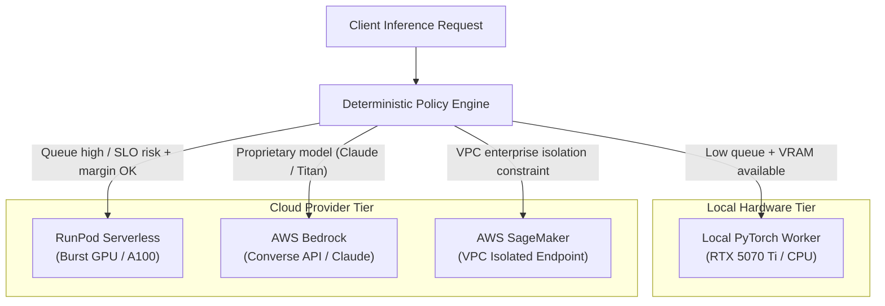

# Inference Provider Setup & Operational Guide

This guide describes how to configure, authenticate, automate, and verify both local and cloud inference providers within the **Multi-Tenant AI Inference Platform**:
- **Local PyTorch / CUDA Engine** (RTX 5070 Ti / CPU fallback)
- **RunPod Serverless GPU** (Dynamic burst capacity)
- **AWS Bedrock** (Managed foundation models via Converse API)
- **AWS SageMaker** (Dedicated / VPC-isolated endpoints)

---

## 1. Provider Architecture & Routing Role

The platform utilizes a provider-agnostic port interface (`InferenceProvider`), allowing high-level tenant workloads to route dynamically between on-premise hardware and external cloud compute based on measurable constraints:



---

## 2. Automated Provider Setup & Diagnostics

The repository provides an automated verification script at `scripts/setup_providers.py`.

### 2.1 Diagnostics Check
Run diagnostics to verify hardware detection, active environment variables, and adapter readiness:
```bash
python3 scripts/setup_providers.py --check
```

### 2.2 Generate Sanitized Environment Template
Generate a sanitized `.env.providers.example` file:
```bash
python3 scripts/setup_providers.py --generate-env
```

### 2.3 Test Prediction Across Providers
Execute a test inference job directly through any provider adapter (in live or mock mode):
```bash
python3 scripts/setup_providers.py --test-prediction --provider local_pytorch
python3 scripts/setup_providers.py --test-prediction --provider runpod
python3 scripts/setup_providers.py --test-prediction --provider bedrock
python3 scripts/setup_providers.py --test-prediction --provider sagemaker
```

---

## 3. How to Activate Live Calls (De-mocking)

The platform defaults external cloud adapters to **safe mock mode** (`*_MOCK=1`) so that developers and CI suites can run full lifecycle tests offline without incurring paid cloud compute bills.

> [!IMPORTANT]
> **Local PyTorch is ALWAYS Live**: The `local_pytorch` adapter runs real neural network forward passes directly on your local GPU (e.g. NVIDIA GeForce RTX 5070 Ti) using PyTorch CUDA tensors without any mocking.

To activate live remote cloud execution for RunPod, AWS Bedrock, or AWS SageMaker:

### 3.1 Live Activation Variables

| Provider | Mock Variable | Required Live Credentials / Settings | Verification Command |
|---|---|---|---|
| **Local PyTorch** | *None (Always Live)* | `LOCAL_INFERENCE_DEVICE=auto` | `python3 scripts/setup_providers.py --test-prediction --provider local_pytorch` |
| **RunPod Serverless** | `RUNPOD_MOCK=0` | `RUNPOD_API_KEY="rpa_..."`<br>`RUNPOD_ENDPOINT_ID="vllm-..."` | `python3 scripts/setup_providers.py --test-prediction --provider runpod` |
| **AWS Bedrock** | `BEDROCK_MOCK=0` | `AWS_REGION="us-east-1"`<br>`AWS_ACCESS_KEY_ID="AKIA..."`<br>`AWS_SECRET_ACCESS_KEY="..."` | `python3 scripts/setup_providers.py --test-prediction --provider bedrock` |
| **AWS SageMaker** | `SAGEMAKER_MOCK=0` | `AWS_REGION="us-east-1"`<br>`SAGEMAKER_ENDPOINT_NAME="..."`<br>AWS credentials (or IAM IRSA in EKS) | `python3 scripts/setup_providers.py --test-prediction --provider sagemaker` |

### 3.2 Quick Live Activation Example
Run in your shell or set in your local environment:
```bash
# 1. Activate Live RunPod Serverless
export RUNPOD_MOCK=0
export RUNPOD_API_KEY="rpa_your_live_runpod_api_key"
export RUNPOD_ENDPOINT_ID="vllm-llama3-8b-endpoint-id"

# 2. Activate Live AWS Bedrock Converse API
export BEDROCK_MOCK=0
export AWS_REGION="us-east-1"
export AWS_ACCESS_KEY_ID="AKIA_YOUR_AWS_KEY"
export AWS_SECRET_ACCESS_KEY="your_aws_secret"

# 3. Activate Live AWS SageMaker Endpoints
export SAGEMAKER_MOCK=0
export SAGEMAKER_ENDPOINT_NAME="sagemaker-llama3-70b-instruct"

# 4. Verify live connectivity with diagnostics CLI
python3 scripts/setup_providers.py --check
```

### 3.3 Verifying Live Mode in Traces, Logs, and Dashboards
Once live variables are exported:
1. **Diagnostics CLI**: `python3 scripts/setup_providers.py --check` displays `Mode: live` for enabled providers.
2. **Worker Logs**: Process logs print `[PROVIDER_EXECUTION] job_id=... provider=runpod mode=live is_mocked=false`.
3. **OpenTelemetry Traces**: Distributed spans record attributes:
   - `provider.name`: `"runpod"` / `"bedrock"` / `"sagemaker"`
   - `provider.execution_mode`: `"live"`
   - `provider.is_mocked`: `false`
4. **Grafana Operations Dashboard**: The panel **"Provider Execution Mode (Mock vs Live Environment)"** automatically displays green for `LIVE (Cloud / CUDA)` and orange for `MOCKED (Offline Dev)`.

---

## 4. Provider-Specific Setup Instructions

### 3.1 Local PyTorch / CUDA Engine
- **Target**: NVIDIA GPU (e.g. GeForce RTX 5070 Ti) or CPU fallback.
- **Prerequisites**:
  - NVIDIA Driver $\ge 550.00$
  - CUDA Toolkit 12.x
  - Python virtual environment with PyTorch (`torch >= 2.0`)
- **Configuration**:
  ```bash
  LOCAL_INFERENCE_DEVICE=auto   # 'cuda', 'cpu', or 'auto'
  LOCAL_MODEL_CACHE_DIR=models/ # Relative path to model weights
  ```
- **Verification**:
  ```bash
  python3 -m apps.worker.consumer --healthcheck --provider local_pytorch
  ```

---

### 3.2 RunPod Serverless GPU
RunPod Serverless provides pay-per-second burst GPU compute (e.g. NVIDIA A100 80GB, L40S, or RTX 4090) to handle sudden spikes in local queue depth.

1. **Obtain API Key**:
   - Log in to [RunPod Web Console](https://www.runpod.io/).
   - Navigate to **Settings** $\rightarrow$ **API Keys** and generate a new key.
2. **Deploy or Select Serverless Endpoint**:
   - Under **Serverless**, create an endpoint using a vLLM or Hugging Face worker template.
   - Note the **Endpoint ID** (e.g. `vllm-llama3-8b-abc123xyz`).
3. **Configure Environment**:
   ```bash
   RUNPOD_MOCK=0                           # Set to 0 for live REST API calls
   RUNPOD_API_KEY=rpa_your_actual_api_key
   RUNPOD_ENDPOINT_ID=your_runpod_endpoint_id
   ```
4. **Offline / CI Mocking**:
   If `RUNPOD_MOCK=1` or `RUNPOD_API_KEY` is not set, the adapter transparently simulates realistic A100 GPU compute latency, token generation, and hardware telemetry without spending funds.

---

### 3.3 AWS Bedrock (Converse API)
Amazon Bedrock enables access to managed frontier models (Anthropic Claude 3 / 3.5, Meta Llama 3 70B, Amazon Titan) via token-based billing.

1. **Request Model Access**:
   - Open AWS Bedrock Console $\rightarrow$ **Model Access**.
   - Click **Modify Model Access** and enable the required foundation models (e.g. Anthropic Claude 3 Sonnet).
2. **Configure Least-Privilege IAM Policy**:
   Attach the following IAM statement to the worker role or user:
   ```json
   {
     "Version": "2012-10-17",
     "Statement": [
       {
         "Sid": "BedrockConverseAccess",
         "Effect": "Allow",
         "Action": [
           "bedrock:InvokeModel",
           "bedrock:ListFoundationModels"
         ],
         "Resource": [
           "arn:aws:bedrock:*::foundation-model/*"
         ]
       }
     ]
   }
   ```
3. **Configure Environment**:
   ```bash
   BEDROCK_MOCK=0                      # Set to 0 for live AWS API calls
   AWS_REGION=us-east-1
   AWS_ACCESS_KEY_ID=AKIA...           # Or IRSA / IAM instance profile
   AWS_SECRET_ACCESS_KEY=...
   BEDROCK_DEFAULT_MODEL=anthropic.claude-3-sonnet-20240229-v1:0
   ```
4. **Offline / CI Mocking**:
   When `BEDROCK_MOCK=1` or credentials are unset, the adapter returns structured Converse API responses with standard token accounting and provider-reported telemetry.

---

### 3.4 AWS SageMaker (Dedicated / Async Endpoints)
SageMaker Real-Time endpoints are optimal for proprietary or fine-tuned model weights requiring customer VPC isolation.

1. **Deploy Model Endpoint**:
   - Deploy a SageMaker endpoint using HuggingFace Text Generation Inference (TGI) or AWS JumpStart on an instance such as `ml.g5.2xlarge`.
   - Record the endpoint name (e.g. `sagemaker-llama3-70b-instruct`).
2. **Configure IAM Policy**:
   ```json
   {
     "Version": "2012-10-17",
     "Statement": [
       {
         "Sid": "SageMakerEndpointInvocation",
         "Effect": "Allow",
         "Action": [
           "sagemaker:InvokeEndpoint",
           "sagemaker:DescribeEndpoint"
         ],
         "Resource": "arn:aws:sagemaker:*:*:endpoint/sagemaker-*"
       }
     ]
   }
   ```
3. **Configure Environment**:
   ```bash
   SAGEMAKER_MOCK=0
   AWS_REGION=us-east-1
   SAGEMAKER_ENDPOINT_NAME=sagemaker-llama3-70b-instruct
   ```
4. **Offline / CI Mocking**:
   When `SAGEMAKER_MOCK=1`, the adapter simulates `ml.g5.2xlarge` execution with full VRAM and latency profiling.

---

## 4. REST API Routing Endpoints

The Fastify control plane provides routing management and inspection routes:

- `GET /v1/routing/providers`:
  Inspect provider health, latency P95, cost rates, and mock status.
- `POST /v1/routing/evaluate`:
  Evaluate a deterministic routing policy against workload requirements, queue backlog, latency SLO, and gross margin targets.
- `POST /v1/routing/simulate`:
  Run parameter sweep simulations across queue depths to verify spillover transitions.
- `PATCH /v1/routing/providers/:name/health`:
  Dynamically toggle provider health status for failover and chaos verification.

---

## 5. Security & Secret Protection

In compliance with repository policy:
- Never commit active API keys, credentials, or `.env.providers` files to source control.
- Use `.env.providers.example` as a sanitized template.
- In production, inject credentials using AWS Secrets Manager, SSM Parameter Store, or Kubernetes Secrets via HashiCorp Vault / External Secrets Operator.

