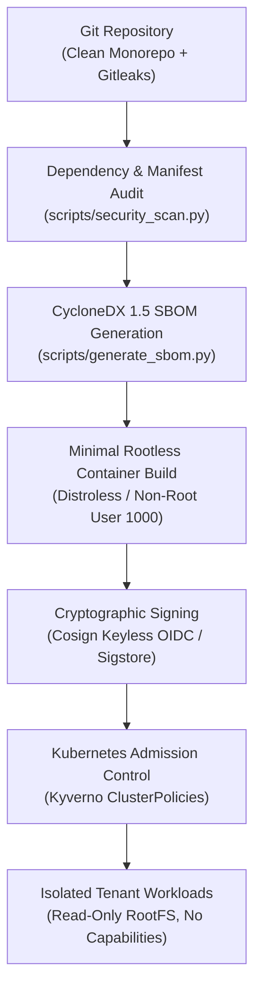

# Software Supply Chain & Security Architecture (M09)

This document describes the software supply-chain controls, container admission policies, SBOM generation, vulnerability scanning, and cryptographic signing architecture for the **Multi-Tenant AI Inference Platform**.

---

## 1. Supply Chain Defense-in-Depth

The platform enforces software supply-chain integrity across code, dependencies, build artifacts, container images, and Kubernetes runtime admission:



---

## 2. Software Bill of Materials (SBOM)

The repository provides an automated CycloneDX 1.5 JSON SBOM generator at `scripts/generate_sbom.py`. It cataloges both Node.js (npm) and Python (PyPI) dependencies:

```bash
# Generate CycloneDX JSON SBOM
python3 scripts/generate_sbom.py --output docs/security/sbom.json
```

Output:
- Format: `CycloneDX 1.5 (JSON)`
- Package URL (`purl`) specification for standard vulnerability database matching (`pkg:npm/...`, `pkg:pypi/...`).
- Cataloged in `docs/security/sbom.json`.

---

## 3. Vulnerability & Security Policy Scanner

Run static analysis against Kubernetes manifests, Helm templates, container configurations, and dependency definitions:

```bash
# Execute repository security scanner
python3 scripts/security_scan.py
```

Enforced policies:
1. **Pod Security Standards**: Verifies `runAsNonRoot: true` and `runAsUser >= 1000`.
2. **Capability Dropping**: Prohibits privileged containers and requires dropping `ALL` Linux capabilities.
3. **Namespace Isolation**: Disallows `hostPID`, `hostIPC`, and `hostNetwork`.
4. **Dependency Pinning**: Rejects wildcard versions (`*`, `latest`) in manifests.

---

## 4. Container Image Signing (Cosign & Sigstore)

Container images deployed to production EKS clusters are signed using **Sigstore / Cosign** via GitHub Actions OIDC identity.

### 4.1 Signing Pipeline (GitHub Actions)
```bash
# Keyless signing via GitHub Actions OIDC
cosign sign --yes "${IMAGE_URI}@${IMAGE_DIGEST}"
```

### 4.2 Kyverno Verification Policy
Kyverno verifies cryptographic signatures before admitting worker or API pods:
```yaml
apiVersion: kyverno.io/v1
kind: ClusterPolicy
metadata:
  name: verify-image-signatures
spec:
  validationFailureAction: Enforce
  rules:
    - name: verify-sigstore-signature
      match:
        any:
          - resources:
              kinds:
                - Pod
      verifyImages:
        - imageReferences:
            - "ghcr.io/multi-tenant-ai-platform/*"
          attestors:
            - entries:
                - keyless:
                    issuer: "https://token.actions.githubusercontent.com"
                    subject: "https://github.com/*"
```

---

## 5. Kubernetes Runtime Admission Policies (Kyverno)

Standalone declarative Kyverno ClusterPolicies reside in `deploy/k8s/kyverno/`:
- `disallow-root-execution.yaml`: Mandates `runAsNonRoot: true` across all pods.
- `require-drop-all-capabilities.yaml`: Drops all POSIX capabilities to stop container breakouts.
- `require-readonly-root-filesystem.yaml`: Requires read-only root filesystems (`readOnlyRootFilesystem: true`).
- `enforce-tenant-namespace-isolation.yaml`: Requires explicit `platform.ai/tenant` workload tags.
- `disallow-host-namespaces.yaml`: Blocks host PID, IPC, and network access.

